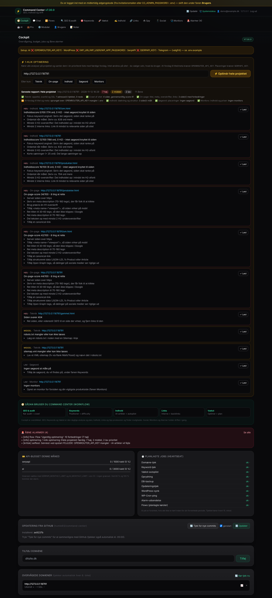

# Command Center v7.28 PRO

[](https://github.com/humle93/command-center/actions/workflows/ci.yml)

Selv-hostet SEO- og drifts-center (FastAPI + SQLite) i stil med RankMath Pro / Yoast Premium — bygget til Steamgears.
Alt kører på din egen server: dine data, ingen abonnement. Se [docs/ROADMAP.md](docs/ROADMAP.md) for hvad der er færdigt og hvad der er næste.

## Nyheder i v7.28

- **Funktionsrevision (v7.28.1)** — alle 63 formularer og knapper er kørt igennem to gange (uden nøgler og med eksterne tjenester fra lokale fakes), og alle 16 faner er åbnet i Chromium. To fejl er rettet: **AI-omskrivning af titel/meta** (fanen SEO) gik altid ned med 500, når der var en AI-nøgle (`ai_chat()` fik et `temperature`-argument, der forsvandt med OpenRouter i v7.25, og svaret blev ikke læst som JSON), og en **pris-monitor** krævede et "forventet"-felt, den slet ikke bruger — et tomt felt gav en tavs side uden monitor. Nu kan pris-monitoren oprettes uden feltet, og en manglende værdi for de andre typer forklares under Alarmer
- **Eget domæne eller offentlig IP — ingen Cloudflare, ingen token, ingen nginx (v7.28.0)** — `bash scripts/ultracc_setup.sh --domain www.ditdomaene.dk` (eller `--ip`) viser planen; localhost og lokalnet afvises, og `--apply` udfører den: stopper `cloudflared`, sætter `CC_HOST=0.0.0.0`, `CC_PORT` og `CC_PUBLIC_URL=http://<ip>:<port>` i `.env`, skifter en gammel systemd-enhed ud (den havde `--host 127.0.0.1 --port 8000` skrevet fast og ignorerede `.env`), genstarter og tjekker at `http://<ip>:<port>/login` svarer. Derefter logger du ind med e-mail og adgangskode på `http://<ip>:<port>/`. **Obs:** uden TLS sendes adgangskoden ukrypteret — brug en stærk, unik kode. Samtidig lukket: `client_ip()` stolede på `X-Forwarded-For` fra alle, så en klient direkte på IP'en kunne omgå login-låsen ved at skifte header; nu bruges headeren kun fra en betroet proxy (127.0.0.1 + `CC_FORWARDED_ALLOW_IPS`)
- **Almindeligt login via Ultra.cc — ingen Cloudflare-tunnel (v7.28.0)** — Ultra.cc's egen nginx giver kun en understi på din faste adresse (`https://<bruger>.<server>.usbx.me/cc/`), og appen kunne før kun ligge på roden af et domæne; derfor blev der brugt en `trycloudflare`-tunnel, hvis URL skiftede ved hver genstart. Nu kan appen ligge på en understi: sæt `CC_PUBLIC_URL=https://<bruger>.<server>.usbx.me/cc`, læg `deploy/nginx-ultracc-proxy.conf` i `~/.apps/nginx/proxy.d/` og log ind på `…/cc/` med e-mail og adgangskode som altid. `bash scripts/ultracc_setup.sh --url https://<bruger>.<server>.usbx.me/cc` viser planen (tunnel, `.env`, nginx-blok), og med `--apply` stopper den `cloudflared`, retter `.env`, lægger blokken ind, genstarter og tjekker at `…/cc/login` svarer 200. Et ASGI-lag (`BasePathMiddleware`) fjerner `/cc` fra indgående kald og sætter det på redirects, session-cookien (`Path=/cc`), links/formularer/scripts i HTML og på `fetch()`-kald; uden understi er alt som før. Se [Installation og udrulning §2e](docs/Installation_og_udrulning.md#2e-ultracc-uden-cloudflare) for skridtene og hvordan tunnellen fjernes

## Nyheder i v7.27

- **Log ind fra WordPress med ét klik (v7.27.0)** — knappen **Log ind i Command Center** i Steamgears Autopilot (7.76+) logger nu direkte ind. Command Center sender sin adresse (`CC_PUBLIC_URL`) og en hemmelig nøgle til pluginnet (`POST /sgap/v1/cc-link`) ved hver sync; knappen signerer en billet (HMAC-SHA256, 60 sekunder, tilfældigt `jti`), og `GET /cc-sso` tjekker signatur, udløb og engangsbrug og logger kun ind som en bruger, der allerede findes med samme e-mail. Afviste billetter tæller med i login-låsen (5 fejl = 10 min.), og hvert login fra WordPress står under Alarmer. Det gamle engangslink (v7.17.5) er fjernet: det sendte til `/sgap/v1/login-link`, en rute pluginnet aldrig har haft, så det kunne ikke virke. Knappen **🔑 Forbind login-knappen nu** i fanen Social forbinder med det samme i stedet for at vente på næste sync

## Nyheder i v7.26

- **Chat med MCP-connectors (v7.26.0)** — ny fane **💬 Chat**, hvor du taler med AI'en (OpenRouter) og giver den værktøjer fra eksterne MCP-servere: **GitHub** (officiel server), dine **WordPress-sites** (Steamgears via `.env` eller ethvert site med WordPress MCP Adapter), **WordPress.com**, **Gmail**, **Google Drive** og enhver anden MCP-server med Streamable HTTP. Værktøjer, der kun læser, kører automatisk; alt, der ændrer noget (sende mail, slette et indlæg, lukke et issue), venter på, at du trykker **Godkend** i chatten. Nøgler gemmes i databasen og vises aldrig igen (kun de sidste fire tegn), connector-adresser går gennem SSRF-guarden, og hver bruger ser kun sine egne samtaler. Gmail, Drive og WordPress.com kræver OAuth hos udbyderen: indsæt URL + token fra en MCP-server/gateway — login med OAuth direkte fra Command Center er ikke bygget endnu

## Nyheder i v7.25

- **AI via OpenRouter (v7.25.0)** — alle AI-funktioner (artikler, outreach-drafts, interne link-forslag, meta-rewrites og AI-synlighed) kalder nu OpenRouter i stedet for aimlapi. Sæt `OPENROUTER_API_KEY` (fra openrouter.ai/keys) og vælg model med `AI_MODEL` som OpenRouter-slug (`udbyder/model`). De tre kaldesteder er samlet i én `ai_chat()`, som også forstår OpenRouters fejlsvar, og månedsloftet `AI_MONTHLY_LIMIT` tæller nu kald til `openrouter.ai`. Står kun den gamle `AIMLAPI_KEY` i `.env`, bruges den ikke, men opstarten skriver en advarsel og lægger en alarm, så AI ikke forsvinder i stilhed

## Nyheder i v7.24

- **Vækst-fanen (v7.24.0)** — en lokal udgave af det, Surfer, Ahrefs, Semrush og BabyLoveGrowth gør, uden API-nøgle: **indholdsoptimerer** med vægtet 0-100-score, termdækning og prioriteret forbedringsliste, **sammenligning** med op til tre konkurrent-URL'er du selv peger på, **indholdsplan** med briefs (mål for ord og H2, termer, overskrifter og konkurrenternes vinkler) og en **linkliste** med kontakt, begrundelse og status. Alt regnes lokalt — ingen nøgler, ingen eksterne AI-kald og ingen data der forlader serveren
- **Moderniseret UI (v7.24.0)** — navigationen er delt i grupper (overblik, analyse, produktion, drift, system) med tydelig aktiv fane, hver fane har en kort beskrivelse øverst, og kort, felter, knapper og tabeller har fået én fælles visuel rytme. Funktioner, ruter og genveje er de samme

## Nyheder i v7.22

- **Backup i UI (v7.23.0)** — fanen Moduler viser alle backups med "Tag backup nu" og "Gendan". Gendannelse kræver at skrive `GENDAN`, og der tages altid en `pre-restore`-kopi først.
- **Offline dashboard (v7.22.0)** — dashboardet henter ikke længere Tailwind, Alpine eller Chart.js fra CDN. De ligger lokalt i `app/static/vendor/`, så UI'et virker uden internet.

## Nyheder i v7.21

- **CSRF-beskyttelse (v7.21.0)** — muterende kald fra et andet site afvises med 403. Hvert login giver en ny session, og den gamle sid slettes.

## Nyheder i v7.20

- **Budget og jobstatus på Cockpit (v7.20.0)** — kortet "API-budget denne måned" viser forbrug og loft for SerpAPI og AI, og "Planlagte jobs (heartbeat)" viser hvornår hvert job sidst kørte. Et job der holder op med at køre, eller fejler, giver én alarm.

## Nyheder i v7.19

- **Standardbruger fra `.env` (v7.18.0)** — er `users` tom, oprettes kontoen ved opstart fra `CC_ADMIN_EMAIL` + `CC_ADMIN_PASSWORD`, så et nyt deployment kan logge ind med det samme; `/setup` er reserve. Koden skal skiftes ved første login, og en rettet `.env` rører ikke en konto i brug.
- **`.env` rydder sig selv (v7.19.1–v7.19.2)** — skifter standardbrugeren koden under Brugere, fjernes `CC_ADMIN_PASSWORD` fra `.env`, og dashboardet viser hvem og hvornår. En advarsel vises, hvis linjen alligevel er forældet.
- **Autopilot-broen læser hele `/snapshot` (v7.19.0)** — selvtjek, cron-forsinkelse og pause-årsag i ét kald, reserve til `/stats` for ældre plugins, og CC holder WP-Cron i gang hvert 5. minut.

## Nyheder i v7.17

**Standardbrugeren i `.env` — ét samlet forløb (v7.18 → v7.20).** Hele vejen fra kontoen oprettes, til filen ikke kan komme til at lyve om koden. De fire trin bygger på hinanden og vises i appen som én nyhed (v7.20.0):

- **Kontoen oprettes ved deployment (v7.18.0)** — skriv `CC_ADMIN_EMAIL` + `CC_ADMIN_PASSWORD` i `.env`, så oprettes kontoen ved opstart, og du kan logge ind med det samme; opsætningssiden er ikke længere en del af et normalt deployment. Koden gemmes kun som PBKDF2-hash, kontoen oprettes med `must_change_password` (gul bjælke indtil du skifter den under fanen **Brugere**), og der seedes kun, når `users` er tom — en senere ændring af `.env` rører ikke en konto i brug. Er linjerne tomme, er `/setup` stadig reserven. Adgangskoden står kun i `.env` (gitignored), aldrig i repoet eller i loggen
- **Advarsel når koden er forældet (v7.18.1)** — skifter du koden under **Brugere**, passer `CC_ADMIN_PASSWORD` ikke længere. Så skriver opstartsloggen `[cc] advarsel: …`, advarslen ligger under **Alarmer**, og dashboardet viser en rød bjælke, indtil du retter eller fjerner linjen i `.env`. Kontoen røres ikke — login bruger den nye kode
- **Linjen rydder sig selv (v7.19.1)** — skifter **du** koden under **Brugere**, tømmes `CC_ADMIN_PASSWORD` i `.env` automatisk (kun den linje; kommentarer og de andre nøgler står urørt). Så kan filen ikke komme til at love en kode, login afviser. Kan filen ikke skrives, ændres intet ved kontoen — så bliver advarslen fra v7.18.1 stående i stedet
- **Dashboardet viser rydningen (v7.19.2)** — øverst står en blå bjælke med tidspunkt og navn, fx "CC_ADMIN_PASSWORD blev fjernet fra .env 5. november 2026 kl. 23:19 af henning", så du kan se filens tilstand uden at åbne den. Sætter du linjen tilbage i `.env`, skifter bjælken tekst og siger det, så den ikke påstår noget forkert; bliver koden samtidig forældet, vinder den røde advarsel. Kun navn og tidspunkt gemmes (i `settings` under `env_password_cleared`) — aldrig en kode — så rydningen også ses efter en genstart

- **MCP-hærdning (v7.17.1)** — nøglen ligger ikke længere i klartekst i databasen: rækken i `settings` slettes i samme kald som dashboardet viser den (højst 15 min. hvis siden aldrig åbnes, og oprydningen fjerner resten). "Jeg har gemt nøglen"-knappen er derfor væk. Ukendte værktøjsnavne på `/mcp` havner nu også i auditten, så en nøgle der famler kan ses.
- **MCP skriver nu også (fase 2)** — med `read,write` på nøglen kan en agent starte et site-crawl, oprette en monitor, løse en alarm og skrive en note (`start_crawl`, `add_monitor`, `resolve_alarm`, `add_note`). Hvert kald — også afviste — havner i en **audit pr. nøgle** (`api_audit`) med værktøj, varighed og fejl, som du ser i fanen **Brugere** og med `python3 scripts/api_key.py audit`. Værktøjerne har `readOnlyHint`/`destructiveHint`, så klienten kan advare før et kald.
- **MCP-adgang (fase 1)** — agenter og editorer kan læse Command Center direkte. Under fanen **Brugere** opretter du en nøgle pr. klient (ingen fælles token); den vises én gang, gemmes kun som sha256 og kan tilbagekaldes enkeltvis. `POST /mcp` tilbyder syv læse-værktøjer: `health`, `crawl_summary`, `keywords`, `monitors`, `alarms_open`, `notes` og `history`. Endpointet validerer `Origin`/`Host` (DNS-rebinding) og svarer `401` med `WWW-Authenticate` uden nøgle — se [docs/Command_Center_MCP.md](docs/Command_Center_MCP.md).
- **E-mail er login (v7.15)** — første besøg opretter din bruger med e-mail + adgangskode (`/setup`), derefter logger du ind med e-mail og adgangskode (PBKDF2-SHA256, salt pr. bruger, 30 dages HttpOnly-session). Gamle konti fra brugernavn-tiden kan stadig logge ind med deres brugernavn, indtil de får en e-mail.
- **Invitation på mail (v7.15, svar i v7.17.2)** — fanen **Brugere** har "Inviter bruger": du skriver en e-mail, og appen sender en invitation med en midlertidig adgangskode, som brugeren skifter ved første login (dashboardet minder om det). Der er ingen invite-links og ingen tokens - kun en adgangskode. Svaret lander i den samme formular: blev mailen sendt, står der hvilken adresse den gik til, og fejler den, står mailserverens fejl der med det samme i stedet for kun under Alarmer. En adresse, der ligner eksemplet fra dokumentationen (`navn@domaene.dk`), afvises med en forklaring i formularen — så en pladsholder eller tastefejl ikke bliver en konto uden modtager; er adressen rigtig alligevel, oprettes den med knappen **Opret alligevel**.
- ⏱️ **Fremdrift på opgaver** — tunge handlinger (crawl, AI-artikel, keyword-tjek, backlink-prospecting …) viser timer, procent og "~N s igen"; crawl læser de rigtige tal (sider/total + ETA) fra `/api/crawl/status`
- **Opdatering fra GitHub** — Cockpit viser installeret commit vs. seneste commit på `main`, tjekker selv kl. 05:00, og "Opdater" laver DB-backup og henter kun projektets filer. Den gamle "hent install.sh og kør den"-vej er fjernet.
- **nginx / Ultra.cc** — `deploy/nginx-command-center.conf`, `deploy/command-center.user.service` og proxy-header-understøttelse, så appen bliver på `127.0.0.1` bag nginx med korrekte Secure-cookies og rigtig klient-IP.
- **Rettelser fra kodegennemgang** — saniteret artikel-HTML (XSS), `.env` læses før konfigurationen, pris-monitors registrerer ændringer igen, crawl-diff virker (to crawls gemmes), `/monitors/add` giver ikke længere 500, HTTPS-advarslen rammer rigtigt, plus mindre korrekthedsrettelser.

## Funktioner

- 💬 **Chat** — tal med AI'en og giv den værktøjer fra MCP-connectors (GitHub, WordPress, Gmail, Google Drive m.fl.); skrivende værktøjer kræver din godkendelse
- 🎛️ **Cockpit** — domæneovervågning (uptime, svartid, SSL), opdaterings-panel og alarmer
- 🔍 **SEO Scanner** — deep audit af enkelt side (20+ vægtede kontroller inkl. focus keyword, læsbarhed, mixed content, schema, OG/Twitter) + **site-crawl** med score per side, robots.txt/sitemap-tjek og crawl-diff mod forrige crawl
- ✍️ **Artikler** — AI-generering (via OpenRouter, model i `AI_MODEL`) eller skabelon, **push til WordPress som udkast**, **fakta-prompt med SerpAPI-konkurrentanalyse**, autopilot (idé → artikel → WP-kladde) og **kvalitetsgate** før publicering
- 🎯 **SEO-strategi** — AdSense / Affiliate / Backlink-vækst styrer AI-artiklernes stil + længde og autopilotens arbejde, med automatisk pre-flight-checkliste
- 🌱 **Growth Pack** — backlink-prospector (SerpAPI top 10 → sitetype + kontakt-e-mail + AI-outreach-draft), keyword-ideer via Google/DDG-autocomplete, visibility-index
- 🎯 **Keywords** — Google-positioner via SerpAPI (dagligt kl. 06:00), sværhedsgrads-heuristik, content gap mod top 10
- 🚀 **Vækst** — lokal indholdsoptimering uden API-nøgle: score og termdækning for en tekst eller URL, sammenligning mod op til tre konkurrent-URL'er, indholdsplan med briefs og en manuel linkliste. Måler kun det, der står i teksten — ingen søgevolumen, ingen backlink-data
- 🕷️ **SERP & Spy** — konkurrent-opdagelse + crawl af titel/H1/beskrivelse
- 🔗 **Links** — ekstern linktjek + AI-forslag til interne links
- 📱 **Social** — opslagskø med CSV-export og "→ Autopilot" (kladde i WordPress-pluginnet — kun **én** kladde pr. opslag, også ved dobbeltklik). Planlagt tid indtastes i lokal tid og gemmes som **lokal tid + UTC**, så sommertid ikke flytter opslaget
- 🩺 **Monitors** — tekst/JSON/pris-overvågning med alarmer ved ændring
- 🤖 **AI-synlighed** — stil en kundes spørgsmål til AI-modellen og se, om `TRACK_DOMAIN` nævnes i svaret (historik i `ai_visibility`)
- 📝 **Noter** — hurtige workflow-noter i dashboardet (`/notes/add`, `/notes/delete`)
- 👤 **Brugere** — invitér/slet brugere, skift adgangskode og opret **MCP-nøgler** pr. klient (hash, scopes, tilbagekald); den sidste bruger kan ikke slettes, og både en gennemført og en afvist sletning svarer i fanen med det samme i stedet for kun at ende som en alarm
- 🚨 **Alarmer** — SSL-udløb, nedetid, brudte links, fejlede scans, nye GitHub-commits; valgfrit Telegram-push
- 📈 **Historik** — svartid per domæne, site-health og visibility over tid (Chart.js)

## Skærmbilleder



Cockpit med opdaterings-panel og alarmer. Login-siden og alle 16 faner ligger i `docs/img/`
(`cc-login.png`, `cc-cockpit.png` … `cc-notes.png`); billederne er taget med
`python3 scripts/screenshots.py` mod den kørende app, og samme kommando opdaterer dem — se
[manualens afsnit om screenshots](docs/Command_Center_Bruger_og_Systemmanual.md#opdater-screenshots).

## Login & opsætning

1. `cp .env.example .env` og udfyld nøgler — bl.a. `CC_ADMIN_EMAIL` + `CC_ADMIN_PASSWORD` til standardbrugeren, så den findes efter deployment
2. `./run.sh` — scriptet udskriver den adresse appen lytter på (samt LAN-IP når `CC_HOST=0.0.0.0`)
3. Åbn adressen: **standardbrugeren oprettes ved opstart**, så du logger ind med e-mail + adgangskode med det samme (koden fra `.env` skal skiftes under fanen **Brugere** ved første login). Er de to linjer tomme, opretter første besøg brugeren via `/setup` i stedet — det er reserven. Der er ingen token i `.env`.
4. Nye brugere inviteres på mail, og sletning/adgangskode-skift klares under fanen **Brugere** (kræver `SMTP_HOST` + `SMTP_FROM`); fra serveren kan samme invitation sendes med `python3 scripts/invite.py navn@domaene.dk` — og med `--print` udskrives mailen i stedet, så den kan sendes fra en anden mailkonto når SMTP ikke er sat op. Scriptet tager én adresse ad gangen og afviser eksempel-adresser som `navn@domaene.dk`, så en tastefejl ikke bliver en bruger. Helt uden mail kan brugeren oprettes direkte med `python3 scripts/user_create.py navn@domaene.dk --username humle91` (koden skrives skjult og skal være min. 8 tegn)
5. (VPS) kør bag reverse proxy med TLS, eller brug `deploy/command-center.service` + SSH-tunnel
6. Vil du have en agent på? Opret en nøgle under **Brugere → MCP-adgang** og peg klienten på `https://<din-adresse>/mcp` (se nedenfor)

## MCP-adgang (v7.16)

Fase 1 er **læse-adgang** (syv værktøjer); fase 2 tilføjer fire **skrive-værktøjer** med `write`-scope
og audit pr. nøgle. Alt over MCP (Streamable HTTP, JSON-svar) på `/mcp`.

```bash
# nøgle fra terminalen (samme tabel som UI'et) - vises kun én gang
python3 scripts/api_key.py create "Claude Desktop" read

# prøv endpointet
curl -s https://<din-adresse>/mcp -H "Authorization: Bearer cc_..." \
     -H 'Content-Type: application/json' \
     -d '{"jsonrpc":"2.0","id":1,"method":"tools/list"}'
```

- Nøglen sendes altid i `Authorization: Bearer …` (aldrig i query string) og gemmes kun som hash. Den vises **én gang** — rækken med klartekst slettes i samme kald som dashboardet viser den.
- `scopes`: `read` (kun læsning) eller `read,write` (læsning + de fire skrive-værktøjer). Manglende scope giver `-32003`.
- `Origin`/`Host` valideres mod `CC_PUBLIC_URL`; ukendt vært giver `421`, fremmed origin `403`.
- Ukendte værktøjsnavne og manglende scopes havner også i auditten (`ok=0`), så et nøgle der prøver ting af kan ses.
- `python3 scripts/api_key.py list` viser nøglerne (kun halen), `revoke <id>` slår dem fra med det samme, og `audit [antal]` viser de seneste kald pr. nøgle.
- Læse-værktøjer: `health`, `crawl_summary`, `keywords`, `monitors`, `alarms_open`, `notes`, `history`.
- Skrive-værktøjer (`write`): `start_crawl` (afvises hvis et crawl kører), `add_monitor` (samme url+type oprettes ikke to gange), `resolve_alarm`, `add_note`.

## Offentlig adresse: eget domæne eller offentlig IP (enklest)

```bash
bash scripts/ultracc_setup.sh --domain www.ditdomaene.dk                     # plan - skriver intet
bash scripts/ultracc_setup.sh --domain www.ditdomaene.dk --apply             # http://www.ditdomaene.dk:<port>
bash scripts/ultracc_setup.sh --domain www.ditdomaene.dk --port 80 --apply   # uden :port (kræver root)
bash scripts/ultracc_setup.sh --ip --apply                                   # uden domæne: http://<offentlig-ip>:<port>
```

Kun **offentlige** adresser: localhost og lokalnet (10.x, 192.168.x, 172.16-31.x, 100.64-127.x, 169.254.x) afvises, fordi de ikke kan nås fra internettet. Et domæne skal have en A-post, der peger på serverens offentlige IP; scriptet slår den op og stopper med en forklaring, hvis den mangler eller peger på lokalnet. Port 80 (adressen uden `:port`) kræver root — det har man ikke på Ultra.cc, så dér bliver adressen `http://www.ditdomaene.dk:<port>`.

Med `--ip` findes IP'en selv (kun offentlige; angiv den med `--ip 203.0.113.5`), porten tages fra `--port`, `CC_PORT` eller `app-ports free`. Åbn `http://<ip>:<port>/` og log ind med e-mail og adgangskode. Svarer adressen fra serveren selv, men ikke fra din computer, blokerer en firewall porten. Uden TLS sendes koden ukrypteret; vil du have https, så brug nginx-vejen nedenfor.

## Ultra.cc / nginx (reverse proxy)

1. `.env`: `cp .env.example .env` og udfyld nøglerne. Sæt `CC_PUBLIC_URL` til **præcis** den adresse du åbner i browseren — med `https://` og uden anførselstegn. På Ultra.cc er det din faste adresse + understien (`CC_PUBLIC_URL=https://<bruger>.<server>.usbx.me/cc`); på en VPS med eget subdomæne kun værten (`https://cc.eksempel.dk`). Sæt `CC_PORT` til en ledig port (Ultra.cc: `app-ports free`). Lad `CC_HOST=127.0.0.1` og `CC_FORWARDED_ALLOW_IPS=127.0.0.1` stå. `install.sh` skriver kun `.env.example`, og opdateringer rører aldrig `.env` — så linjen forbliver tom, indtil du selv udfylder den
2. Start appen: `./run.sh`, eller `deploy/command-center.user.service` med `systemctl --user enable --now command-center`
3. Ultra.cc: kopiér `deploy/nginx-ultracc-proxy.conf` til `~/.apps/nginx/proxy.d/command-center.conf`, ret porten og kør `app-nginx restart` (filen er kun `location`-blokke — Ultra.cc har selv `server { }` og TLS). VPS: læg `deploy/nginx-command-center.conf` ind i din `server { }` og genindlæs nginx. Ingen Cloudflare-tunnel er nødvendig
4. Åbn `CC_PUBLIC_URL` — standardbrugeren fra `.env` kan logge ind med det samme (er linjerne tomme, opretter første besøg din bruger via `/setup`)

`CC_PUBLIC_URL` styrer login-linket i `scripts/update.sh` og `scripts/user_create.py`, adressen i invitationsmailen og Host-tjekket på `/mcp`. Tjek med `bash scripts/update.sh --check`: står der `127.0.0.1` som login-adresse, er linjen tom eller skrevet forkert. Er `/mcp` utilgængelig med `421`, er det samme linje — værten skal matche ord for ord, og et sæt anførselstegn omkring værdien er nok til at ødelægge den.

Det skal med i proxy-blokken:

- `proxy_set_header X-Forwarded-Proto $scheme;` — ellers tror appen den kører på http: session-cookien bliver ikke `Secure`, og der vises en HTTPS-advarsel
- `proxy_set_header X-Forwarded-For $proxy_add_x_forwarded_for;` — så login-låsen pr. IP rammer klienten i stedet for nginx
- `proxy_read_timeout 300s;` — crawl, content gap og backlink-prospecting kan tage minutter (ellers 504 fra nginx)
- Understi (v7.28): appen kan ligge på `https://host/cc/`, når stien står i `CC_PUBLIC_URL` (eller `CC_BASE_PATH`). nginx skal sende stien videre uændret (`proxy_pass http://127.0.0.1:<port>;` uden `/` til sidst); appen fjerner den selv. Ultra.cc-blokken sætter `X-Forwarded-Proto https` fast, fordi usbx.me-adressen altid er https

## Opdatering fra GitHub

Panelet i Cockpit sammenligner installeret commit med seneste commit på `main`:

- **Tjek for nye commits** (`POST /update/check`) — viser SHA, dato og commit-besked, eller den præcise fejl (manglende token, 401/403, 404). Kører også automatisk kl. 05:00.
- **Opdater** (`POST /update/apply`) — tager en `pre-update`-backup af databasen, henter commit-tarballen og skriver **kun** projektets filer (`app/`, `scripts/`, `deploy/`, requirements, start-scripts, `install.sh`, Dockerfile, compose, `.env.example`). `.env`, databasen og `..`-stier røres ikke.
- **Alt i ét hug**: er `requirements.txt` ændret, køres `pip install -r` automatisk, og appen **genstarter sig selv** ~1,5 s efter svaret (systemd-unit, ellers `scripts/restart.sh` med pidfile + `run.sh`). Fjern fluebenet "genstart" i panelet, eller sæt `UPDATE_AUTO_RESTART=0`, for at genstarte manuelt. `UPDATE_RESTART_CMD` overstyrer kommandoen (fx din egen supervisor).
- **Fra terminalen**: `bash scripts/update.sh` gør hele kæden (tjek → filer → requirements → genstart) og venter til `/health` svarer igen; `--check` tjekker kun, `--no-restart` springer genstarten over. Øverst viser scriptet **tre** versioner ved siden af hinanden: den der **kører nu** (fra `/health`), den **filerne** indeholder (`app/main.py`), og den **installatøren** vil skrive (`install.sh`s indlejrede `app/main.py`) — plus login-adressen fra `CC_PUBLIC_URL`. `bash scripts/update.sh --version` er den samme kontrol som rent svar: kode 0 kun når alle tre stemmer, ellers kode 1 med en linje om hvad der er galt. Opdateringen bruger kontrollen selv: er `install.sh` på disken ældre end koden, skriver den **ingen** filer — den stopper med kode 7 og siger, at installatøren skal hentes fra git først (`git checkout -- install.sh`). `bash scripts/restart.sh` genstarter uden at opdatere.
- Status som JSON: `GET /api/update` (inkl. `restart_mode` og `auto_restart`). Kræver `GITHUB_TOKEN` (privat repo). `/self-update` findes stadig som alias for `/update/apply`.

## Steamgears Autopilot-bro (WordPress-plugin 7.5+)

Command Center og WordPress-pluginnet **Steamgears Autopilot** snakker sammen via pluginnets REST-API
(`/wp-json/sgap/v1`) med de samme `WP_URL` / `WP_USER` / `WP_APP_PASSWORD` som WordPress-push
(`WP_USER` skal være administrator).

- **Status hver 30. min** (fanen Social → "Steamgears Autopilot"): kø, kladder der venter på godkendelse, og udgivet/klik/ordrer/omsætning pr. kanal de sidste 30 dage. Hentes fra pluginnets `GET /snapshot` (ét kald) med pluginversion, pause-årsag, WP-Cron-forsinkelse og pluginnets eget selvtjek; ældre plugins uden `/snapshot` læses via `/stats` + `/drafts` som før
- **Alarmer** når noget ændrer sig: nye fejlede opslag, nye kladder, nye problemer i pluginnets selvtjek, manglende tabeller, eller pluginnet svarer ikke
- **WP-Cron holdes i gang**: CC kalder `wp-cron.php` hvert 5. min, så pluginnets job (udgivelse, selvtjek) kører til tiden, selvom sitet har få besøg
- **Pluginnet ser CC**: hvert kald sender `X-Command-Center: <version>`; Steamgears Autopilot 7.33+ viser "Command Center connected" i sit selvtjek og melder et problem, hvis CC har været tavs i over 2 timer
- **"→ Autopilot"** sender et opslag som kladde til pluginnet (godkendes i WordPress under Steamgears → AI Drafts). Opslaget sendes **kun én gang**: rækken låses før kaldet, så et dobbeltklik eller et genforsøg ikke giver to kladder. Svarer WordPress ikke (timeout), bliver status "sendt? (svar udeblev)" — tjek AI Drafts, før du sender igen
- **Log ind fra WordPress med ét klik (v7.27)** — Command Center sender sin adresse (`CC_PUBLIC_URL`) og en hemmelig nøgle til pluginnet (`POST /cc-link` på `sgap/v1`, Steamgears Autopilot 7.76+) ved hver sync, kun når noget har ændret sig. Knappen **Log ind i Command Center** i WordPress signerer en billet (HMAC-SHA256, 60 s, `jti`), og `GET /cc-sso` logger ind som brugeren med samme e-mail. **🔑 Forbind login-knappen nu** i fanen Social forbinder med det samme. Uden `CC_PUBLIC_URL` (https) forbindes intet, og fanen siger hvorfor
- Slå til/fra under Moduler ("Autopilot-bro"). Retningen er altid CC → site, så CC kan blive på 127.0.0.1
- **Begge sider viser, hvornår CC sidst kaldte**: hvert kald har `X-Command-Center`-headeren, så WordPress noterer tid, version, rute og bruger (`sgap_cc_seen`). Pluginnets kort viser alderen (`live` / `late` / `silent`), og fanen Social viser **WordPress' eget svar** — samme tal, regnet ud ved visning. Er broen brudt, siger begge sider det i stedet for at se stille ud

## Installering

```bash
curl -H "Authorization: Bearer <TOKEN>" -H "Accept: application/vnd.github.raw" \
  https://api.github.com/repos/humle93/command-center/contents/install.sh -o install.sh && bash install.sh
```

Eller med Docker: `cp .env.example .env && docker compose up -d --build`. `install.sh` er selvstændig og
skriver alle filer (inkl. `deploy/nginx-command-center.conf` og `deploy/command-center.user.service`).

## Drift & test

- **Cron**: domæne-tjek hver 6. time, keyword-tjek 06:00, autopilot 05:15, oprydning 04:30, DB-backup 04:40, GitHub-tjek 05:00, Autopilot-bro hver 30. min, WP-Cron-ping hvert 5. min
- **Backup**: `app/backups/cc-daglig-*.db` (14 gemmes) + `cc-pre-update-*.db` før hver opdatering. Gendan fra Moduler-fanen (skriv `GENDAN`)
- **Health**: `/health` (200, eller 503 ved kritisk DB/disk-tilstand) viser også månedens API-forbrug
- **Tests**: `python3 tests/test_v8_features.py` (enhedstests), `bash tests/ci_check.sh` (boot + alle sider + auth + WordPress-bro + link-audit)
- **Screenshots**: `python3 scripts/screenshots.py` tager login-siden og alle 16 faner ind i `docs/img/` (kræver `pip install playwright` + `python3 -m playwright install chromium`; kør mod en kørende app med `--base/--user/--password`). CI **fejler**, hvis billederne er ældre end dashboard-skabelonen — skriv `[skip screenshots]` i commit-beskeden, når ændringen ikke påvirker udseendet
- **Fælles agentregler i alle repoer**: `bash scripts/agents_md_rollout.sh --dry-run` viser planen, og uden `--dry-run` lægger den `AGENTS.md` ind i alle dine repoer som branch + PR (kræver `gh` logget ind). En eksisterende fil overskrives kun med `--overwrite`, og `main` røres aldrig
- **Scripts i `scripts/`**: alle otte har samme header — `navn - formål`, `Brug:`, `Kraever:` og `Sidst aendret` — og er eksekverbare. `bash scripts/update.sh -h` (og `--help` på de øvrige med flag) læser headeren, så hjælpen ikke kan drive fra scriptet. Versionsnumre står ikke i headere: de læses fra `APP_VERSION` i `app/main.py`

## Alarmer (v7.12)

Alarmer går til flere kanaler: **Telegram**, **e-mail** (SMTP), **ntfy** og en **signeret webhook**.
De sendes ikke inline — de skrives i køen `alert_outbox` og leveres af et job med backoff
(30 s → 2 min → 10 min → 1 t, maks. 5 forsøg), så en langsom modtager aldrig blokerer appen.
Ens alarmer dedupliceres inden for `ALERT_DEDUPE_MINUTES`, stille timer (`ALERT_QUIET_HOURS=23-7`)
udskyder alt under "kritisk" til vinduet slutter, og webhooken signeres efter Standard Webhooks
(`webhook-id`, `webhook-timestamp`, `webhook-signature: v1,...` = HMAC-SHA256 over
`id.timestamp.body`). Fanen **Alarmer** viser hvilke kanaler der er sat op, har test-knapper pr.
kanal og lister fejlede leveringer med årsag og antal forsøg. Fremdriftskortet dækker alle tunge
handlinger — crawl med rigtig procent, resten med ærlige skøn (`TASK_ESTIMATES`), nu også
testalarmer og GitHub-opdatering.

## Opstart, login og IP (v7.13)

Ved hver opstart skriver appen version og de nyeste aendringer til skaermen, til
`app/data/startup.log` og til `settings.last_start` - og de samme nyheder er med i `GET /health`.
`run.sh`, `run.bat`, `scripts/restart.sh`, `scripts/update.sh` og `install.sh` viser version + nyheder,
saa man ikke skal huske hvilken version der kører. `scripts/update.sh` går to skridt videre: den viser
versionen på disken, den version processen svarer med i `/health` **og** den version `install.sh` vil
skrive, advarer hvis de er forskellige, og skriver login-adressen (`CC_PUBLIC_URL` + `/login`, dvs. den
adresse nginx videresender). `bash scripts/update.sh --version` giver samme kontrol som rent svar:
kode 0 kun når alle tre stemmer, ellers kode 1 med en linje om hvad der er galt — så en gammel
`install.sh`, der ville overskrive koden med en ældre version, bliver opdaget før man kører den.

Login logger nu IP: `users.last_login_ip`/`last_login_at`, `sessions.ip` og tabellen `login_attempts`
(ok/fejl, 30 dage) - vist under fanen **Brugere** sammen med de seneste forsoeg. IP'en hentes fra
`X-Forwarded-For` (foerste hop) med socket-adressen som reserve, saa den er korrekt bag nginx.
Login-siden viser en kort **kørselsrapport** uden at man er logget ind: version + commit, seneste
opstart, åbne alarmer, antal domæner/keywords/monitors, seneste domænetjek og crawl, DB-størrelse og
din IP - ingen alarmtekster eller brugernavne.

## Agenter og skills (v7.13.2)

Fem agenter i tre grupper, plus en skill. Se `.agents/README.md` for detaljer og spawn-eksempler.

| Repo | Agenter |
|---|---|
| **Command Center** (dette repo) | `command-center-reviewer` (regler/kontrakter), `cc-verifier` (tests, ruter, installer-paritet), `site-seo-auditor` (SEO ud fra appens DB), `mcp-access-auditor` (MCP-nøgler, scopes, audit, transport) |
| **Social Autopilot** (tjenesten) | `social-autopilot-auditor` (`/drafts`, `/autopilot/sync`, kanaler, idempotens, tidszoner) |
| **Social Autopilot Android** (mobilklienten) | `social-autopilot-android` (API-paritet, Keystore, offline-kø, release) |

- `.agents/skills/command-center/SKILL.md` — en **skill** med reglerne, kontrakterne,
  verify-kommandoerne og faldgruberne. Den bliver slash-kommandoen `/skill:command-center`.
- Alle agenter er **read-only** med vilje; kun `cc-verifier` må køre kommandoer, og den skriver ikke.

De er udviklerværktøj, ikke app-funktioner: de indgår ikke i `install.sh`, og self-update henter dem
ikke. Modellen i agenten står som `anthropic/claude-sonnet-4.5` (Codebuff-docsenes eksempel) — skift
den linje hvis kontoen ikke kan tilgå modellen.

## Dokumentation

**Installation og udrulning af alle tre dele** (Steamgears Autopilot 7.76.0, Command Center 7.27.0 og
wp-auto-deployer), i rækkefølge, med tjekliste, fejlfinding og rollback:
[`docs/Installation_og_udrulning.md`](docs/Installation_og_udrulning.md).

Kodeændringer kræver dokumentation i samme commit: `README.md` plus den relevante fil i `docs/`
(manual ved funktioner, arkitektur ved struktur/jobs/ruter, roadmap ved prioriteringer). `install.sh`
regenereres bagefter, fordi den indeholder kopier af filerne. CI fejler, hvis der ændres kode uden
dokumentation — `[skip docs]` i commit-beskeden springer tjekket over. `CLAUDE.md` er statusnotatet
og handoff, `AGENTS.md` er de korte regler for agenter.

## Sikkerhed

- **Brugere**: PBKDF2-SHA256 med salt pr. bruger; sessioner er HttpOnly-cookies (30 dage) gemt som `sha256(id)` i databasen, så en DB-kopi ikke giver adgang. Skift af adgangskode logger dine andre sessioner ud.
- **Cookie/HTTPS**: cookien sættes `Secure` når appen ser https (kræver `X-Forwarded-Proto` bag proxy — se nginx-afsnittet).
- **API-budget**: SerpAPI og AI-kald til OpenRouter tælles pr. måned og stoppes ved loftet (`SERPAPI_MONTHLY_LIMIT`, `AI_MONTHLY_LIMIT`), med alarm ved 80 % og 100 %. Forbruget vises på Cockpit.
- **Job-heartbeat**: hvert planlagt job skriver sin sidste kørsel; forsinkede eller fejlede jobs alarmeres (v7.20).
- Default binding er 127.0.0.1 — sæt aldrig `0.0.0.0` uden reverse proxy + TLS.
- **SSRF**: alle udgående kald med en URL fra et felt går gennem `safe_request()`. Loopback, private net, link-local (`169.254.169.254` = sky-metadata), reserverede adresser og navne som `.local`/`.internal` afvises, og en viderestilling tjekkes hop for hop — så en 302 ikke kan føre ind i det lokale net. Afvisningen forklares i formularen. Skal CC måle en intern side, åbner `CC_SSRF_ALLOW=vaert.ditdomaene` for netop den værtsadresse.

## Kendte begrænsninger

- Dashboardet henter Tailwind, Alpine.js og Chart.js lokalt fra `app/static/vendor/` (siden v7.22), så det virker uden internetadgang. Login-siden er helt selvstændig.
- Opdatering kræver `GITHUB_TOKEN`; ændringer i `requirements.txt` rapporteres men installeres først ved næste `./run.sh`.
- `install.sh` indeholder kopier af projektets filer (CI tjekker at de matcher); ret derfor altid kildefilerne og kør regen, ikke installeren.
- Screenshots i `docs/img/` er taget med `python3 scripts/screenshots.py` mod v7.26-UI'et (alle 16 faner, inkl. Chat); kør scriptet igen efter større UI-ændringer — CI fejler, hvis du glemmer det.
- **Vækst måler tekst, ikke markedet**: Surfer, Ahrefs og Semrush bygger på egne webindekser og søgedata. Vækst-fanen tæller ord og termer i det indhold, du giver den, og henter kun de konkurrentsider, du selv angiver — derfor ingen søgevolumen, sværhedsgrad, placeringer eller backlink-profiler.
