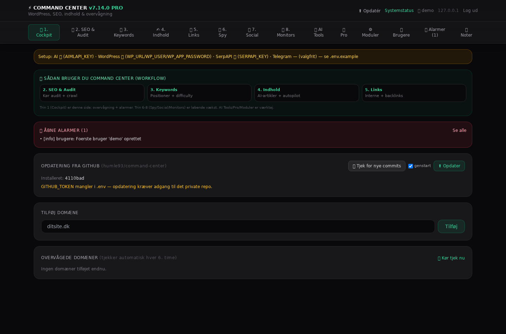
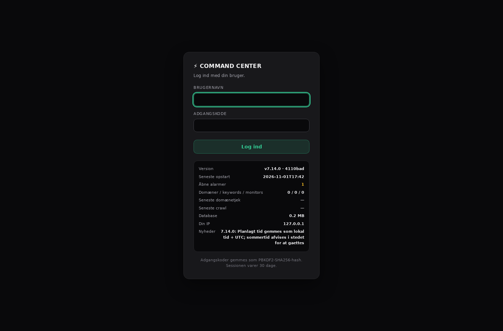
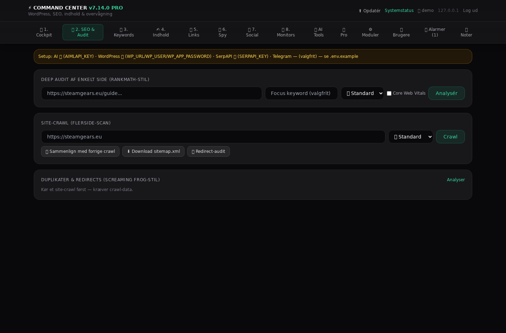
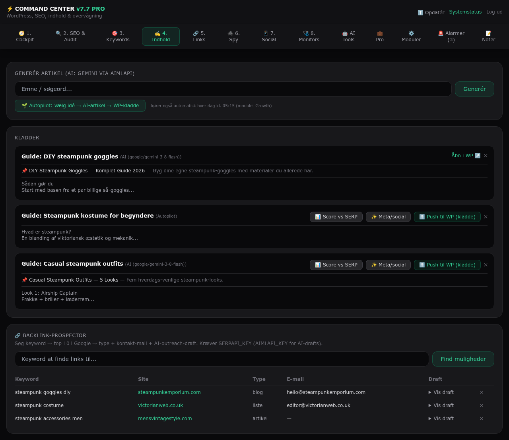
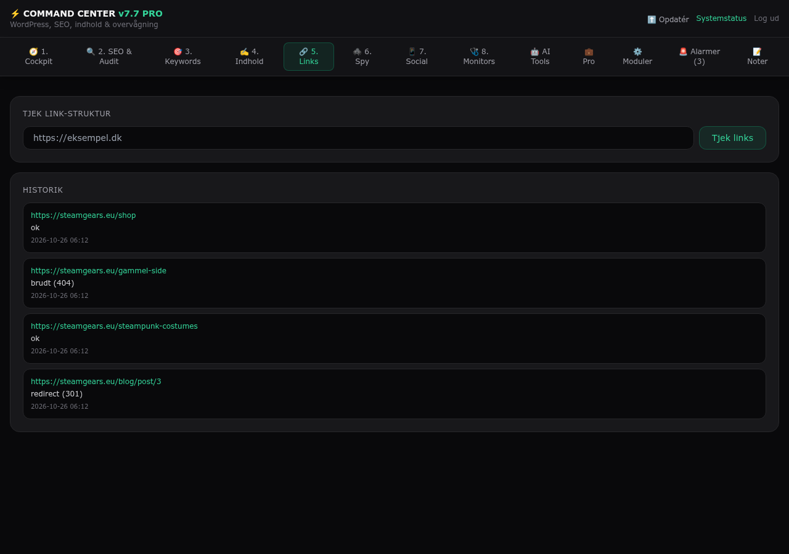
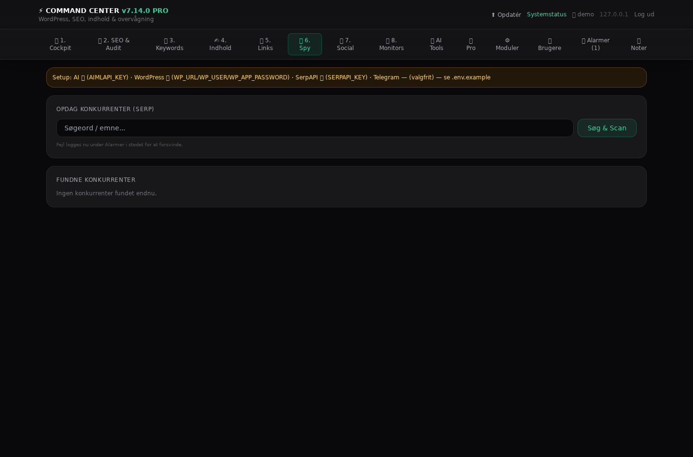
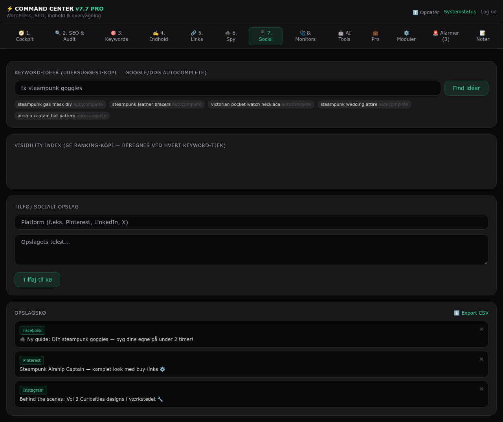
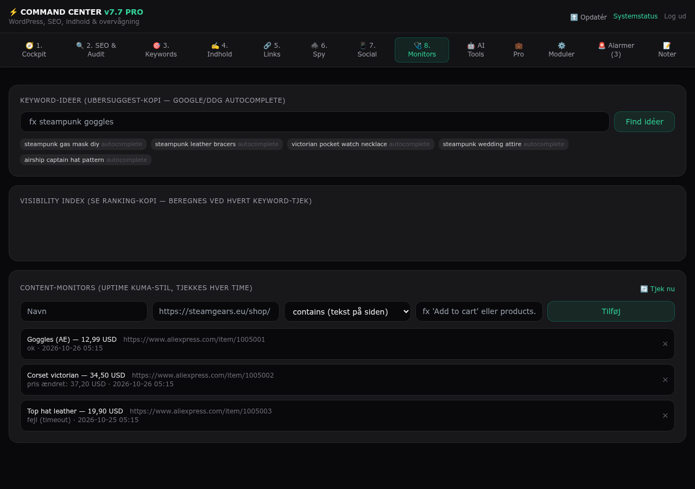
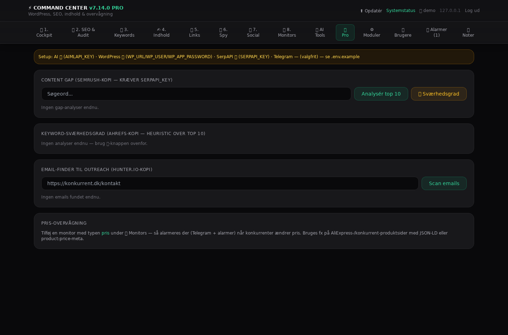
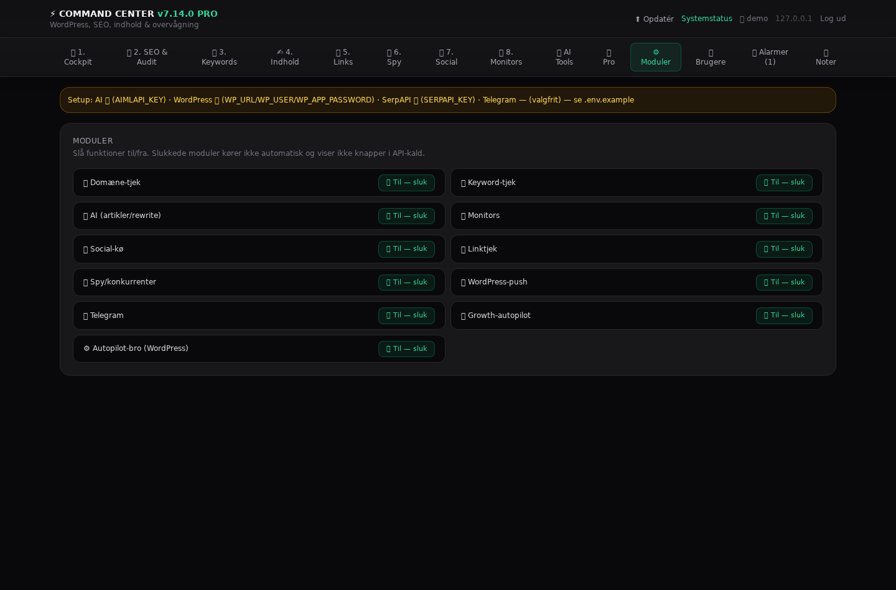

# Command Center v7.11 PRO — Bruger- og systemmanual

Selv-hostet SEO- og drifts-center til steamgears.eu (FastAPI + SQLite). Alt kører på din egen server — dine data, ingen abonnement.



> Screenshots i `docs/img/` er fra v7.8-UI'et. Funktionaliteten er den samme, men login er nu brugerbaseret, og Cockpit har fået et opdaterings-panel.

---

## Login og brugere

Første besøg opretter din bruger (`/setup`): brugernavn (3-32 tegn: a-z, 0-9, punktum, bindestreg, underscore) og adgangskode (min. 8 tegn). Adgangskoder gemmes som PBKDF2-SHA256-hash med salt pr. bruger — der er ingen token i `.env`.

Derefter logger du ind med brugernavn og adgangskode. Sessionen er en HttpOnly-cookie, der varer 30 dage, og kan tilbagekaldes ved at logge ud, slette brugeren eller skifte adgangskode.

Under fanen **Brugere**:

- **Opret bruger** — fx en ekstra konto, så du ikke låser dig ude
- **Slet bruger** — den sidste bruger kan ikke slettes; sletter du dig selv, bliver du logget ud
- **Skift min adgangskode** — kræver den nuværende; dine andre sessioner logges ud

Efter 5 fejlede logins fra samme IP er login låst i 10 minutter.




---

## Guidet fanerækkefølge

Fanerne er nummereret i den rækkefølge, et normalt arbejdsflow bruger dem.

### 1. Cockpit — dit daglige overblik

- **Opdatering fra GitHub**: installeret commit vs. seneste commit på `main`, "Tjek for nye commits" og "Opdater" (se nedenfor)
- Domæneovervågning: uptime, svartid, SSL-udløb (historik + graf via 📈)
- **"Sådan bruger du Command Center"**: 4 klikbare trin gennem workflowet
- Alarmer og noter

### Fremdrift på opgaver

Alle tunge handlinger viser et lille kort nederst til højre med timer, procent og forventet resttid ("~20 s igen"). Crawl viser de rigtige tal (sider/total + ETA) fra `/api/crawl/status`, mens de øvrige bruger estimater fra `TASK_ESTIMATES` i `app/main.py`. Tunge formularer viser en kvittering ("… færdig på 14 s"), når siden er genindlæst.

### 2. SEO & Audit

- **Deep audit** af en enkelt side (RankMath-stil): titel, meta, H1-struktur, alt-tekster, intern link-tæthed, Core Web Vitals (hvis `PSI_API_KEY` er sat). Score 0-100 + "AI-rewrite titel/meta"
- **Site-crawl**: flerside-scan med score pr. side, robots.txt/sitemap-tjek, sammenligning med **forrige crawl** (crawl-diff), sitemap-download og redirect-audit
- **Duplikater & redirects**: duplikat-titler/H1, næsten-identisk indhold og redirect-kæder — altid for den seneste crawl

Crawleren gemmer de **to seneste** crawls, så diffen har noget at sammenligne med; ældre ryddes automatisk.



### 3. Keywords

- Tilføj keywords → dagligt Google-positionstjek kl. 06:00 (SerpAPI)
- **Keyword-ideer**: Google/DDG-autocomplete, og autopiloten sår nye når puljen er tom
- **Keyword-sværhedsgrad**: heuristik over top 10 (autoritetsdata, unikke domæner, annoncer)
- **Visibility Index**: samlet synlighed over tid

### 4. Indhold (Artikler)

**SEO-strategi-vælger** (øverst): *AdSense-indkomst*, *Affiliate* eller *Backlink-vækst*. Valget styrer AI-artiklernes stil og længde (manuel generering OG autopilot) og hvad autopiloten gør (artikel vs. prospecting). Efter hvert valg kører CC et **pre-flight-tjek** af nøgler, WordPress-creds, moduler, cron og DB — vist som grøn/rød-checkliste med kritisk alarm ved mangler.

- **Generér artikel**: emne/keyword → AI-artikel (Gemini via aimlapi). Prompten henter top 5 Google-resultater (SerpAPI) og kræver fakta-baseret indhold, der dækker deres content gap
- **Kladde-liste**: hver artikel har *Score vs SERP*, *Meta/social*, *Push til WP (kladde)* og slet
- **Autopilot**: én knap kører hele cyklussen (idé → artikel → WP-kladde). Kører også automatisk kl. 05:15 (modulet *Growth*)
- **Kvalitetsgate**: artikler under `QUALITY_MIN_WORDS` (eller 80 % af SERP-gennemsnittet), uden fokus-keyword eller med under 2 H2 sendes **ikke** til WordPress som autopilot — status bliver "Stoppet af kvalitetsgate" + alarm. Manuel push er tilladt men giver en info-alarm

Artikel-forhåndsvisningen i dashboardet vises med saniteret HTML: kun formatering (h2/h3/p/lister/tabeller/links), ingen scripts, handlers eller `javascript:`-links.



- **Backlink-prospector** (nederst): keyword → top 10 Google-resultater klassificeret (blog/liste/artikel/shop) + kontakt-e-mails + AI-outreach-draft

### 5. Links

- Tjek eksterne links på en side: status (ok/brudt/timeout) med historik. Brudte links = hurtige fixes
- **AI interne link-forslag** (AI Tools): kræver et crawl og `AIMLAPI_KEY`



### 6. Spy

- **SERP Discovery**: find konkurrenter for et keyword
- **Konkurrent-crawl**: titel/H1/meta fra konkurrent-sider — se hvad de ranker med, som du ikke dækker



### 7. Social

- **Steamgears Autopilot**: kø, kladder der venter på godkendelse, og udgivet/klik/ordrer/omsætning pr. kanal (30 dage). "→ Autopilot" sender et opslag som kladde til WordPress-pluginnet
- Opslagskø med CSV-export



### 8. Monitors

- Tekst-, JSON- og **pris**-overvågning. Pris-monitors læser `product:price:amount` eller JSON-LD og alarmerer når prisen ændrer sig (sammenligningen bruger den gemte talværdi, ikke visningsteksten)



---

## AI Tools

Samlede AI-værktøjer: titel/meta-rewrites, outreach-drafts, artikel-meta og interne link-forslag. Bruger `AIMLAPI_KEY` + `AI_MODEL` (default `google/gemini-3-8-flash`, max_tokens 3000 pga. reasoning-tokens). Månedens forbrug tælles og stoppes ved `AI_MONTHLY_LIMIT`.

## Pro

Redirect-audit, crawl-diff, sitemap-generator, keyword-sværhedsgrad, content gap, email-finder og pris-overvågning.



## Moduler

Slå funktionsområder fra/til: `domains, keywords, ai, monitors, social, links, spy, wp_push, telegram, growth, autopilot`.

- **Kerne**: domains + keywords + ai
- **Udvidet**: + monitors, social, links, spy
- **Fuld**: alt inkl. wp_push, telegram, growth

Deaktiverede moduler skjuler UI-knapper og stopper cron-jobs (fx kører growth-autopiloten kun når `growth` er til). Ændringer slår igennem med det samme.



---

## Opdatering fra GitHub

Cockpit-panelet viser **installeret commit** og **seneste commit på `main`**:

- **Tjek for nye commits** (`POST /update/check`) — SHA, dato og commit-besked, eller den præcise fejl: manglende `GITHUB_TOKEN`, 401/403 (udløbet token) eller 404 (forkert `GITHUB_REPO`). Tjekket kører også automatisk kl. 05:00
- **Opdater** (`POST /update/apply`) — tager en `pre-update`-backup af databasen, henter commit-tarballen fra GitHub og skriver **kun** projektets filer (`app/`, `scripts/`, `deploy/`, `requirements.txt`, `run.sh`, `run.bat`, `install.sh`, `Dockerfile`, `docker-compose.yml`, `.env.example`). `.env`, databasen, `app/backups/` og `..`-stier røres ikke
- **Requirements og genstart klarer den selv**: er `requirements.txt` ændret, køres `pip install -r` i venv'en (5 min timeout, resultatet vises i panelet), og appen genstarter ~1,5 s efter svaret — via systemd-unit hvis den findes, ellers `scripts/restart.sh` (pidfile `app/data/cc.pid` + `run.sh`). Genindlæs siden om et øjeblik
- **Fravalg**: fjern fluebenet “genstart” i panelet, sæt `UPDATE_AUTO_RESTART=0`, eller brug `UPDATE_RESTART_CMD` til din egen supervisor-kommando
- **Fra terminalen**: `bash scripts/update.sh` (tjek + filer + requirements + genstart, venter til `/health` svarer), `--check` kun tjek, `--no-restart` uden genstart. `bash scripts/restart.sh` genstarter uden at opdatere
- Status som JSON: `GET /api/update` (inkl. `restart_mode`/`auto_restart`), `POST /api/update/check`, `POST /api/update/apply` (bruges af scriptet). `/self-update` er alias for `/update/apply`

## nginx / Ultra.cc

Appen skal blive på `127.0.0.1`; nginx står for TLS:

1. `.env`: `CC_HOST=127.0.0.1`, `CC_PUBLIC_URL=https://<din-adresse>`, `CC_FORWARDED_ALLOW_IPS=127.0.0.1`
2. Start via `./run.sh` eller `deploy/command-center.user.service` (systemd --user, indlæser `.env` som `EnvironmentFile`)
3. `deploy/nginx-command-center.conf` ind i den `server { }` du bruger, derefter genindlæs nginx
4. Åbn `CC_PUBLIC_URL` — første besøg opretter din bruger

Proxy-blokken skal sende `X-Forwarded-Proto` (ellers bliver cookien ikke `Secure`, og der vises en HTTPS-advarsel), `X-Forwarded-For` (så login-låsen rammer klienten) og have `proxy_read_timeout 300s` (crawl/AI-kald tager minutter). Understi (`/apps/cc/`) virker ikke — brug subdomæne eller egen port.


## API (til automatisering)

Alle routes kræver en indlogget bruger (cookie) - samme session som UI'et. Vigtigste:

- `POST /articles/generate` (form: keyword) · `POST /articles/push` · `POST /articles/autopilot`
- `POST /keywords/add` · `GET /api/visibility` · `GET /api/health-history`
- `POST /backlinks/prospect` · `POST /seo/audit` · `POST /seo/crawl`
- `GET /health` · `POST /settings/module` · `GET /api/update` · `POST /update/check` · `POST /update/apply`
- `POST /self-update` (alias for `/update/apply`)

## Environment-variabler (.env)

`CC_HOST`, `CC_PORT`, `CC_PUBLIC_URL`, `CC_FORWARDED_ALLOW_IPS`, `GITHUB_TOKEN`, `GITHUB_REPO`, `AIMLAPI_KEY`, `AI_MODEL`, `WP_URL/USER/APP_PASSWORD`, `TELEGRAM_*`, `SERPAPI_KEY`, `TRACK_DOMAIN`, `PSI_API_KEY`, `SSL_WARN_DAYS`, `LINKCHECK_LIMIT`, `SERPAPI_MONTHLY_LIMIT`, `AI_MONTHLY_LIMIT`, `QUALITY_MIN_WORDS`.

Rigtige miljøvariabler vinder over `.env`. `.env` læses før appens konfiguration, og inline-kommentarer (`KEY=  # note`) fjernes.

## Drift

- **Cron**: domæne-tjek hver 6. time · keywords 06:00 · autopilot 05:15 · oprydning 04:30 · DB-backup 04:40 · GitHub-tjek 05:00 · Autopilot-bro hver 30. min
- **Backup**: `app/backups/cc-daglig-*.db` (14 gemmes) og `cc-pre-update-*.db` før hver opdatering
- **Health**: `/health` returnerer 503 ved kritisk DB/disk-tilstand og viser månedens API-forbrug
- **Tests**: `python3 tests/test_v8_features.py` og `bash tests/ci_check.sh` (boot, alle sider, auth, WordPress-bro og link-audit)
- **Rollback**: stop appen, gendan `app/data/center.db` fra `app/backups/`, og kør `install.sh`/GitHub-opdatering igen

## Fejlfinding

| Symptom | Tjek |
| --- | --- |
| Bliver logget ud hele tiden | Bag nginx: mangler `X-Forwarded-Proto`? Så sættes cookien ikke `Secure` korrekt, og HTTPS-advarslen vises |
| "GITHUB_TOKEN mangler" i opdaterings-panelet | Sæt token i `.env` (privat repo) og genstart appen |
| 504 fra nginx ved crawl/AI-kald | `proxy_read_timeout 300s` i nginx-blokken |
| Login låst | 5 fejl = 10 min pr. IP; vent eller genstart appen |
| Kan ikke oprette bruger | Brugernavn 3-32 tegn, adgangskode min. 8 tegn |
| Ingen adgang til `/api/*` | Log ind igen - API'et kræver en aktiv session (cookie), ikke en token |
| Appen starter ikke efter opdatering | `pip install -r requirements.txt` (gør `./run.sh`), og se `journalctl --user -u command-center` |

## Installation

```bash
# Hent install.sh fra det private repo (raw-download med din GitHub-token) og kør den
bash install.sh
```

Scriptet selv-installerer (venv, deps, `.env`-skabelon, nginx-config, systemd-unit) og er idempotent.


## Alarmer og kanaler (v7.12)

Alarmer (døde domæner, ændrede priser, fejlede keyword-tjek, budgetloft, strategi-mangler) sendes nu
til de kanaler du sætter i `.env`:

| Kanal | Variabler |
|---|---|
| Telegram | `TELEGRAM_BOT_TOKEN`, `TELEGRAM_CHAT_ID` |
| E-mail | `SMTP_HOST`, `SMTP_PORT`, `SMTP_USER`, `SMTP_PASS`, `SMTP_FROM`, `SMTP_TO`, `SMTP_TLS` |
| ntfy | `NTFY_URL`, `NTFY_TOPIC`, `NTFY_TOKEN` |
| Webhook | `ALERT_WEBHOOK_URL`, `ALERT_WEBHOOK_SECRET` |

`ALERT_MIN_SEVERITY` (info/advarsel/kritisk) filtrerer støj, `ALERT_QUIET_HOURS=23-7` holder
ikke-kritiske alarmer væk om natten, og `ALERT_DEDUPE_MINUTES` (standard 180) sikrer at den samme
alarm ikke spammer. Genstart efter ændringer. Under fanen **Alarmer** ser du hvilke kanaler der er
aktive, kan sende en testalarm pr. kanal, og se hvorfor en levering eventuelt fejlede — appen prøver
automatisk igen med stigende interval i op til fem forsøg.

E-mail kræver en app-adgangskode (Google/Fastmail), ikke din normale adgangskode.
Webhooken kan verificeres med `webhook-signature`-headeren, hvis modtageren kender hemmeligheden.


## Opstart, login-IP og kørselsrapport (v7.13)

Ved opstart printer appen version og de nyeste ændringer. Samme tekst havner i `app/data/startup.log`,
og `run.sh`, `run.bat`, `scripts/restart.sh`, `scripts/update.sh` og `install.sh` viser versionen, så
du altid kan se hvad der kører.

Login registrerer IP'en bag hvert forsøg: under fanen **Brugere** ser du seneste login pr. bruger
(IP + tid) og de sidste otte forsøg, inkl. fejlede. Bag nginx kræver det, at `CC_FORWARDED_ALLOW_IPS`
matcher proxyens adresse (standard `127.0.0.1`), ellers vises proxyens IP.

Login-siden viser en kort kørselsrapport, før du logger ind: version og commit, seneste opstart, åbne
alarmer, antal domæner/keywords/monitors, seneste domænetjek og crawl, database-størrelse og din IP.
Rapporten indeholder bevidst ikke alarmtekster eller brugernavne.
