# Command Center v7.18 PRO — Bruger- og systemmanual

Selv-hostet SEO- og drifts-center til steamgears.eu (FastAPI + SQLite). Alt kører på din egen server — dine data, ingen abonnement.

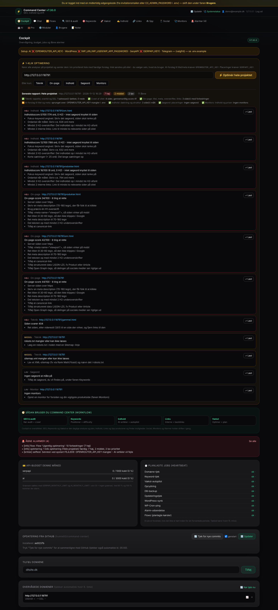

> Screenshots i `docs/img/` er taget med `scripts/screenshots.py` mod den kørende version (v7.24-UI'et). Kør scriptet igen, når UI'et ændrer sig — CI fejler, hvis billederne er ældre end dashboard-skabelonen (se "Opdater screenshots" nedenfor).

---

## Login og brugere

### Standardbruger ved deployment (v7.18)

Skriv `CC_ADMIN_EMAIL` og `CC_ADMIN_PASSWORD` i `.env`, før du starter appen. Ved opstart oprettes kontoen, hvis databasen endnu ikke har brugere, så du kan logge ind med det samme — der er ingen opsætningsside i et normalt deployment. Adgangskoden står **kun** i `.env` (som er gitignored); appen gemmer den som PBKDF2-SHA256-hash med salt pr. bruger og skriver den aldrig i loggen.

- Kontoen oprettes med `must_change_password`, så dashboardet viser en gul bjælke, indtil du skifter koden under fanen **Brugere**. Derefter er `.env`-linjen kun historik — den bruges ikke igen.
- Der seedes **kun**, når `users` er tom. Retter du linjerne senere, ændres en eksisterende konto ikke; brug fanen **Brugere** eller `scripts/user_create.py`.
- Er linjerne tomme, er `/setup` reserven: første besøg opretter brugeren med e-mail og adgangskode. Siden lukker sig selv, så snart der findes en bruger.
- En ugyldig e-mail eller en kode under 8 tegn opretter **ingen** konto; opstartsloggen skriver `fejl: …`, og der kommer en advarsel under fanen **Alarmer**.

### Når `.env`-koden ikke længere passer (v7.18.1)

`.env`-linjen bruges kun ved seed. Skifter du adgangskoden under **Brugere** (eller med `scripts/user_create.py`), bliver `CC_ADMIN_PASSWORD` i `.env` forældet — filen lover en kode, som login ikke længere accepterer. Appen opdager det ved opstart og på dashboardet:

- opstartsloggen skriver `[cc] advarsel: CC_ADMIN_PASSWORD i .env passer ikke længere til 'navn@domaene.dk' …`
- den samme tekst ligger under fanen **Alarmer** (som `advarsel`, med samme dedupe som de andre alarmer)
- dashboardet viser en **rød bjælke** øverst, indtil linjen er rettet eller fjernet

Advarslen ændrer **intet** ved kontoen: login bruger hele tiden den nye kode. Ret `.env` til den kode, du faktisk bruger, eller slet linjen — den skal alligevel ikke bruges igen.

**Siden v7.19.1 rydder linjen sig selv:** skifter du koden under **Brugere** som den konto, `CC_ADMIN_EMAIL` peger på, tømmes `CC_ADMIN_PASSWORD` i `.env` med det samme. Kun den linje ændres — kommentarer og de andre nøgler står urørt, og filen skrives atomisk, så en afbrudt skrivning ikke kan ødelægge den. Herefter findes advarslen og den røde bjælke ikke længere, fordi der ikke er noget at være uenig om.

**Siden v7.19.2 står rydningen i dashboardet:** øverst vises en **blå bjælke** med tidspunkt og navn — fx “CC_ADMIN_PASSWORD blev fjernet fra .env 5. november 2026 kl. 23:19 af henning — filen kan ikke blive forældet”. Du behøver altså ikke åbne `.env` for at se, hvad der står i den. Sætter du linjen tilbage i filen, skifter bjælken tekst og siger det, så den ikke påstår, at filen stadig er ryddet; bliver koden samtidig forældet, viser den røde advarsel i stedet for den blå. Der gemmes kun navn og tidspunkt (i `settings`), aldrig koden — heller ikke i bjælkens tekst.

- Skifter en anden bruger sin kode, eller ændrer du koden med `scripts/user_create.py` eller direkte i databasen, rører appen ikke `.env` — så er advarslen stadig din sikkerhedslineal.
- Er `.env` skrivebeskyttet (fx i en container med filen monteret), ændres kontoen alligevel: skrivningen fejler, fejlen bliver en advarsel under **Alarmer**, og den røde bjælke bliver stående, indtil du fjerner linjen selv. Kontrollen kører kun, når både `CC_ADMIN_EMAIL` og `CC_ADMIN_PASSWORD` er udfyldt, og den sammenligner koden mod den gemte PBKDF2-hash; koden skrives aldrig i loggen eller i advarslen.

### E-mail er login-id

**E-mailen** er dit login-id (gemmes med små bogstaver) og adgangskoden skal være min. 8 tegn. Adgangskoder gemmes som PBKDF2-SHA256-hash med salt pr. bruger — der er ingen token i `.env`.

Derefter logger du ind med e-mail og adgangskode. Konti fra før v7.15 (oprettet med brugernavn) kan stadig logge ind med deres brugernavn; de får adressen `<brugernavn>@local`, indtil de bliver inviteret igen med en rigtig e-mail. Sessionen er en HttpOnly-cookie, der varer 30 dage, og kan tilbagekaldes ved at logge ud, slette brugeren eller skifte adgangskode.

Under fanen **Brugere**:

- **Inviter bruger** — skriv en e-mail, og appen sender en invitation med en midlertidig adgangskode (12 tegn). Brugeren skal skifte den ved første login, og dashboardet viser en gul bjælke indtil da. Invitationen kræver `SMTP_HOST` + `SMTP_FROM` i `.env`: kan mailen ikke sendes, bliver brugeren **ikke** oprettet, og fejlen vises med det samme i formularen (og under fanen Alarmer). Formularen bliver stående på fanen Brugere, så du ikke skal lede efter svaret. Adressen tjekkes **før** der sendes noget: en pladsholder fra dokumentationen (`navn@domaene.dk`) eller en adresse uden `@` forklares i formularen i stedet for at blive en konto, ingen kan modtage post på — og er adressen rigtig alligevel, står der en **Opret alligevel**-knap ved siden af forklaringen
- **Slet bruger** (✕ ud for brugeren) sletter kontoen og dens sessioner, og svaret kommer i fanen med det samme: grønt når brugeren er væk, rødt med en forklaring når sletningen blev afvist. Den sidste bruger kan ikke slettes, så du ikke låser dig ude; et id der ikke findes (fx slettet i en anden fane) eller et tomt id bliver sagt højt i stedet for at se ud som en gennemført sletning
- Sletter du dig selv, bliver du logget ud

Invitationen kan også sendes fra serveren uden browser — samme funktion, samme krav til SMTP:

```bash
python3 scripts/invite.py cpaleadsis@gmail.com                      # adressen kommer fra CC_PUBLIC_URL
python3 scripts/invite.py cpaleadsis@gmail.com --base-url https://cc.example.dk   # eller angiv den selv
python3 scripts/invite.py cpaleadsis@gmail.com --print              # ingen SMTP: udskriv mailen
```

Scriptet skriver, hvad der blev sendt, og stopper med en fejl (intet oprettes), hvis mailen ikke kan sendes.
Med `--print` kræves ingen SMTP: brugeren oprettes med en midlertidig kode, og den færdige mail
(emne + tekst med koden) skrives til skærmen, så den kan sendes fra en anden mailkonto.

Argumenterne tjekkes, **før** der oprettes noget, så en tastefejl ikke bliver en bruger, ingen kan bruge:

- **én e-mailadresse ad gangen** — skal der inviteres flere, køres scriptet én gang pr. adresse. Et ekstra argument giver en fejl i stedet for en ekstra bruger
- adressen i mailen angives som `--base-url https://…`; den gamle form `python3 scripts/invite.py <e-mail> <adresse>` virker stadig, når det andet argument er en http(s)-URL
- **ukendte flag afvises** — fx `--prnt` svarer "mente du --print?" i stedet for stille at sende en rigtig mail
- **eksempel-adresser afvises** — `navn@domaene.dk`, `dit.navn@…` og `example.com` stopper med en forklaring, fordi ingen kan modtage post der. Er adressen rigtig alligevel, tilføj `--force`
- `--help` viser brugslinjen

Ved fejl skrives forklaringen, brugslinjen og "Intet blev oprettet.", og scriptet afslutter med kode 2
(kode 1 = mailen kunne ikke sendes).
### Opret en bruger uden mail

Skal der ikke sendes en invitation — fx din egen konto — kan brugeren oprettes direkte i databasen med
samme tabel og samme PBKDF2-hash som fanen Brugere:

```bash
python3 scripts/user_create.py cpaleadsis@gmail.com --username humle91   # koden spørges der om
python3 scripts/user_create.py navn@domaene.dk --password 'en-lang-kode' # til scripts/automation
python3 scripts/user_create.py navn@domaene.dk --must-change            # skal skifte ved login
```

Koden skrives skjult (to gange, så en tastefejl ikke låser kontoen) og skal være **mindst 8 tegn** —
samme regel som i UI'et. Brugeren kan logge ind med e-mailen **eller** brugernavnet. Koden gemmes kun
som hash med salt pr. bruger, så scriptet skriver den ikke ud igen; glemmer du den, sætter du en ny
under fanen **Brugere**. Adressen i svaret kommer fra `CC_PUBLIC_URL` i `.env`.
- **Skift min adgangskode** — kræver den nuværende; dine andre sessioner logges ud

Efter 5 fejlede logins fra samme IP er login låst i 10 minutter.

Hvert login giver en ny session, og den gamle session slettes. Ændringer, der sker fra en anden side (fx et skjult formularkald fra en anden hjemmeside), afvises med 403 — det er forventet, og du skal blot logge ind igen og prøve fra Command Center.

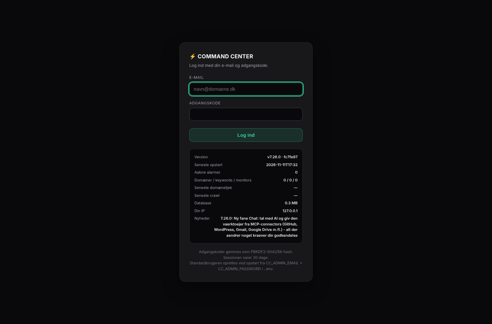


---

## Guidet fanerækkefølge

Navigationen er delt i grupper — **overblik** (Cockpit og Chat), **analyse** (SEO, Keywords, Vækst), **produktion** (Indhold, Links, Spy), **drift** (Social, Monitors, Alarmer) og **system** (AI, Pro, Moduler, Brugere, Noter) — og hver fane har en kort beskrivelse øverst. Afsnittene nedenfor følger samme rækkefølge som et normalt arbejdsflow.

### 1. Cockpit — dit daglige overblik

- **Opdatering fra GitHub**: installeret commit vs. seneste commit på `main`, "Tjek for nye commits" og "Opdater" (se nedenfor)
- Domæneovervågning: uptime, svartid, SSL-udløb (historik + graf via 📈)
- **💳 API-budget denne måned**: forbrug og loft for SerpAPI og AI (OpenRouter). Ved 80 % kommer en advarsel, ved 100 % stoppes de betalte kald
- **⏱️ Planlagte jobs (heartbeat)**: hvornår hvert job sidst kørte OK. Et job der er forsinket eller fejlet giver en alarm (én gang pr. tilstand), og alarmen forsvinder når jobbet kører igen
- **"Sådan bruger du Command Center"**: 4 klikbare trin gennem workflowet
- Alarmer og noter

### Fremdrift på opgaver

Alle tunge handlinger viser et lille kort nederst til højre med timer, procent og forventet resttid ("~20 s igen"). Crawl viser de rigtige tal (sider/total + ETA) fra `/api/crawl/status`, mens de øvrige bruger estimater fra `TASK_ESTIMATES` i `app/main.py`. Tunge formularer viser en kvittering ("… færdig på 14 s"), når siden er genindlæst.

### 2. SEO & Audit

- **Deep audit** af en enkelt side (RankMath-stil): titel, meta, H1-struktur, alt-tekster, intern link-tæthed, Core Web Vitals (hvis `PSI_API_KEY` er sat). Score 0-100 + "AI-rewrite titel/meta"
- **Site-crawl**: flerside-scan med score pr. side, robots.txt/sitemap-tjek, sammenligning med **forrige crawl** (crawl-diff), sitemap-download og redirect-audit
- **Duplikater & redirects**: duplikat-titler/H1, næsten-identisk indhold og redirect-kæder — altid for den seneste crawl

Crawleren gemmer de **to seneste** crawls, så diffen har noget at sammenligne med; ældre ryddes automatisk.

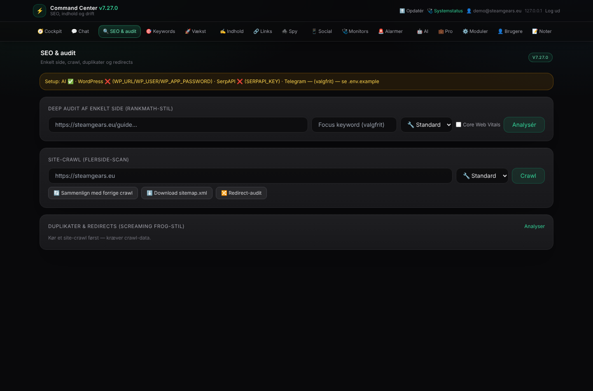

### 3. Keywords

- Tilføj keywords → dagligt Google-positionstjek kl. 06:00 (SerpAPI)
- **Keyword-ideer**: Google/DDG-autocomplete, og autopiloten sår nye når puljen er tom
- **Keyword-sværhedsgrad**: heuristik over top 10 (autoritetsdata, unikke domæner, annoncer)
- **Visibility Index**: samlet synlighed over tid

### 4. Indhold (Artikler)

**SEO-strategi-vælger** (øverst): *AdSense-indkomst*, *Affiliate* eller *Backlink-vækst*. Valget styrer AI-artiklernes stil og længde (manuel generering OG autopilot) og hvad autopiloten gør (artikel vs. prospecting). Efter hvert valg kører CC et **pre-flight-tjek** af nøgler, WordPress-creds, moduler, cron og DB — vist som grøn/rød-checkliste med kritisk alarm ved mangler.

- **Generér artikel**: emne/keyword → AI-artikel (via OpenRouter). Prompten henter top 5 Google-resultater (SerpAPI) og kræver fakta-baseret indhold, der dækker deres content gap
- **Kladde-liste**: hver artikel har *Score vs SERP*, *Meta/social*, *Push til WP (kladde)* og slet
- **Autopilot**: én knap kører hele cyklussen (idé → artikel → WP-kladde). Kører også automatisk kl. 05:15 (modulet *Growth*)
- **Kvalitetsgate**: artikler under `QUALITY_MIN_WORDS` (eller 80 % af SERP-gennemsnittet), uden fokus-keyword eller med under 2 H2 sendes **ikke** til WordPress som autopilot — status bliver "Stoppet af kvalitetsgate" + alarm. Manuel push er tilladt men giver en info-alarm

Artikel-forhåndsvisningen i dashboardet vises med saniteret HTML: kun formatering (h2/h3/p/lister/tabeller/links), ingen scripts, handlers eller `javascript:`-links.

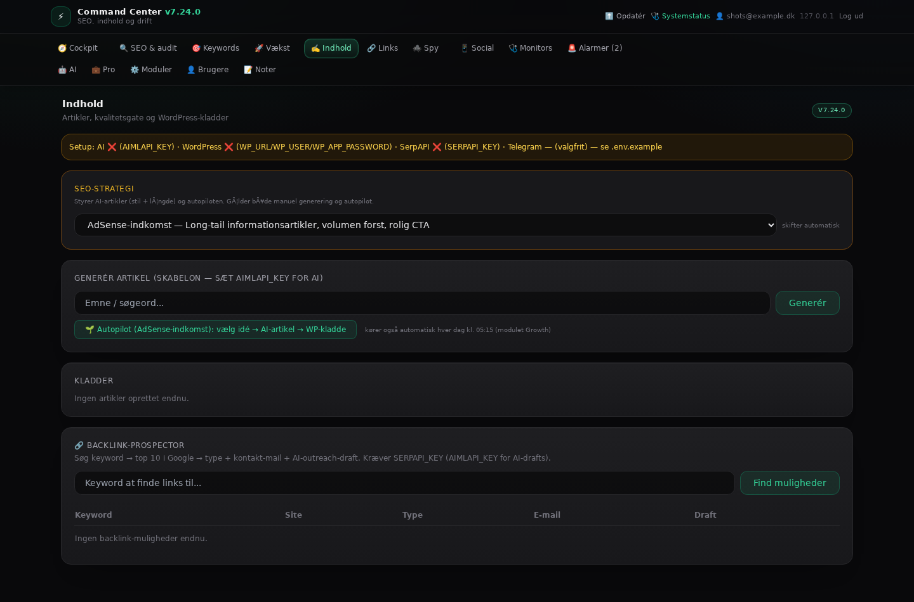

- **Backlink-prospector** (nederst): keyword → top 10 Google-resultater klassificeret (blog/liste/artikel/shop) + kontakt-e-mails + AI-outreach-draft

### Vækst — indhold der er målt (v7.24)

Fanen **🚀 Vækst** er Command Centers egen udgave af det, Surfer, Ahrefs, Semrush og BabyLoveGrowth gør — men **uden API-nøgle**. Alt regnes lokalt ud fra den tekst, du giver den, og de sider du selv peger på.

- **Indholdsoptimerer** — indsæt artikeltekst/HTML eller en URL, og få en vægtet score 0-100 med termdækning og en prioriteret liste af forbedringer. Kontrollerne er: fokus-keyword i titel, H1, første 10 % og mindst to H2, keyword-tæthed 0,5-3 %, mindst tre H2, ordantal mod dit mål, korte sætninger og afsnit, mindst to interne links, meta description 70-160 tegn og dækning af dine relaterede termer. Hver manglende kontrol kommer med et konkret forslag, og de sidste fem målinger gemmes
- **Sammenlign med konkurrenter** — skriv din egen URL og op til tre konkurrent-URL'er. Du får ordantal og H2 pr. side, deres snit, og hvilke emner de dækker, som du ikke gør. Der er ingen SERP-opslag: *du* vælger, hvad der skal måles imod
- **Indholdsplan** — en brief pr. emne med mål for ord og H2, termer, overskrifter og de vinkler konkurrenterne bruger. Er der konkurrent-URL'er med, kommer målene fra deres gennemsnit; ellers bruges standardmålene (1200 ord, 5 H2). Briefen kan flyttes mellem *Planlagt → Skrevet → Publiceret* (eller *Fravalgt*) og planlægges med en dato
- **Linkmuligheder** — din egen liste over sider, du vil have et link fra, med type, kontakt, begrundelse og status (*Ny → Kontaktet → Link aftalt → Link live / Afvist*). Intet sendes automatisk

**Det kan den ikke:** Ahrefs og Semrush bygger på egne webindekser og søgedata, og BabyLoveGrowth på et partnernetværk. Vækst-fanen måler derfor hverken søgevolumen, sværhedsgrad, placeringer eller backlink-profiler — den måler tekst. Tallene er talt fra indholdet, ikke hentet udefra.

### 5. Links

- Tjek eksterne links på en side: status (ok/brudt/timeout) med historik. Brudte links = hurtige fixes
- **AI interne link-forslag** (AI Tools): kræver et crawl og `OPENROUTER_API_KEY`

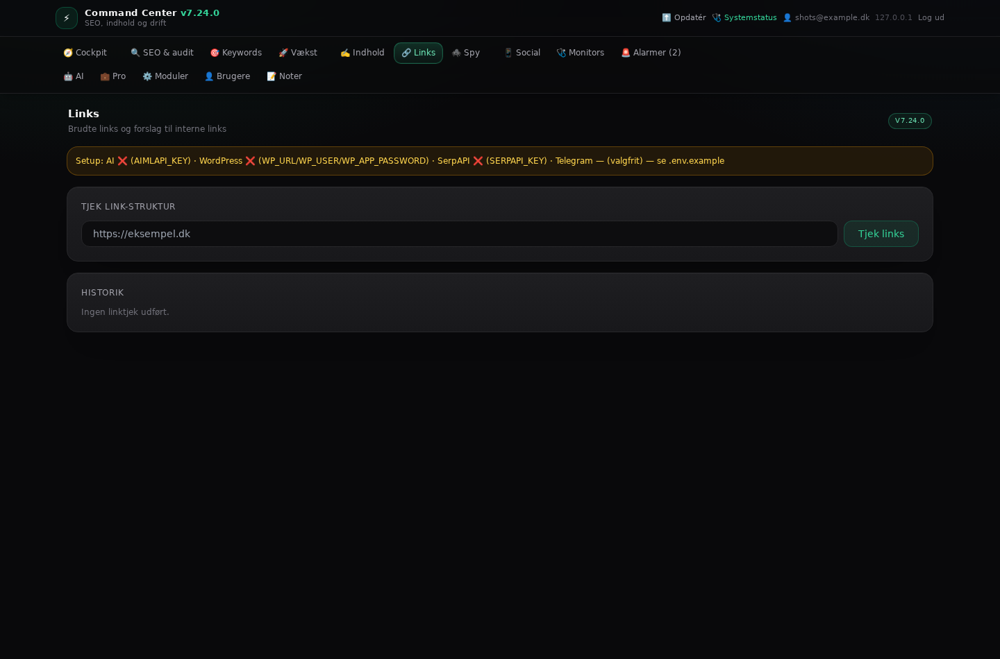

### 6. Spy

- **SERP Discovery**: find konkurrenter for et keyword
- **Konkurrent-crawl**: titel/H1/meta fra konkurrent-sider — se hvad de ranker med, som du ikke dækker

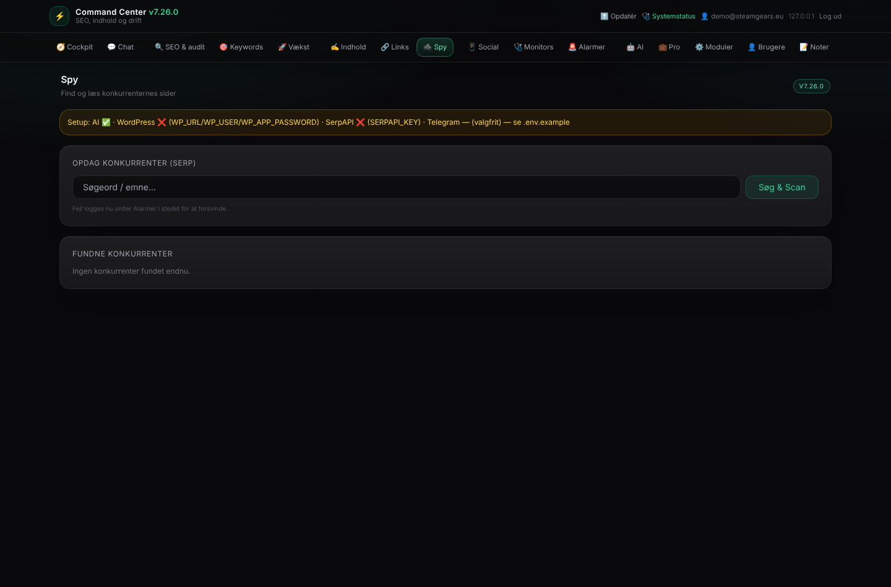

### 7. Social

- **Steamgears Autopilot**: kø, kladder der venter på godkendelse, og udgivet/klik/ordrer/omsætning pr. kanal (30 dage). "→ Autopilot" sender et opslag som kladde til WordPress-pluginnet. **🔑 Log ind på Command Center** lægger et engangslink i pluginnet, så knappen dér logger dig ind her uden adgangskode — linket holder 10 minutter og virker kun én gang; er det brugt, siger login-siden det
- **Hvornår kaldte CC sidst?** Under login-knappen står WordPress' eget svar: fx "WordPress hoerte sidst fra Command Center for 12 min. siden" med version, rute og bruger. Tallet er det samme som kortet i WordPress viser, fordi begge læser pluginnets `sgap_cc_seen` — og det regnes ud ved visning, så det vokser, når der ikke kommer kald. Over 45 min. er en sync-runde misset (gul), over 2 timer er broen sandsynligvis brudt (rød), og så peger linjen på WordPress, `WP_URL`, `WP_USER` og `WP_APP_PASSWORD`. Hvert kald har `X-Command-Center`, som er det, der får WordPress til at notere det
- **Steamgears Autopilot**: kø, kladder der venter på godkendelse, og udgivet/klik/ordrer/omsætning pr. kanal (30 dage). "→ Autopilot" sender et opslag som kladde til WordPress-pluginnet
- **Pluginnets tilstand**: under tabellen vises pluginversionen, en gul linje hvis afsendelsen er sat på pause (med pluginnets årsag) eller WP-Cron er mindst 30 min bagud, og listen fra pluginnets eget selvtjek ("✓ ingen problemer" når den er tom). Et nyt problem giver én alarm; samme problem alarmerer ikke igen hver halve time
- **WP-Cron**: CC kalder `wp-cron.php` hvert 5. min, så sitet ikke behøver en rigtig cron-job for at pluginnet udgiver til tiden. I WordPress viser Steamgears-selvtjekket "Command Center connected", og hvis CC tier i over 2 timer, står det som et problem dér
- **Kun én kladde pr. opslag**: rækken låses før kaldet til WordPress. Et dobbeltklik eller et genforsøg sender derfor intet ekstra, og status skifter til "sender til autopilot" mens kaldet kører. Afviser WordPress kaldet, får opslaget sin gamle status tilbage og kan sendes igen. Svarer WordPress slet ikke (timeout), bliver status "sendt? (svar udeblev)" med en alarm — tjek AI Drafts i WordPress, før du sender igen
- **Planlagt tid**: vælg et tidspunkt i feltet under opslaget. Det viser zonen (`CC_TZ`, standard Europe/Copenhagen), og tiden gemmes både som lokal tid og UTC. "→ Autopilot" sender begge med, så tjenesten og Android-klienten ikke skal gætte. En tid der ikke findes (fx 02:30 den nat sommertiden starter) **afvises** med en alarm i stedet for at blive gættet
- Opslagskø med CSV-export (kolonner for både lokal tid og UTC + zone)

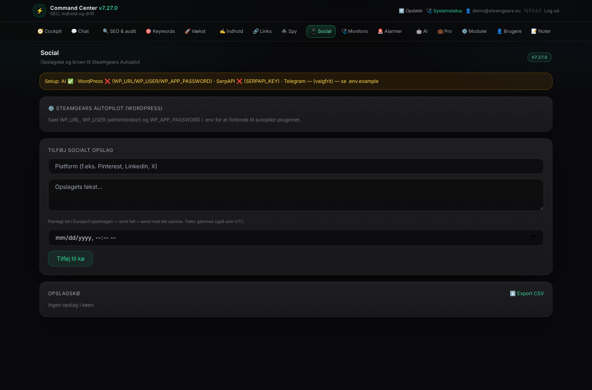

### 8. Monitors

- Tekst-, JSON- og **pris**-overvågning. Pris-monitors læser `product:price:amount` eller JSON-LD og alarmerer når prisen ændrer sig (sammenligningen bruger den gemte talværdi, ikke visningsteksten)

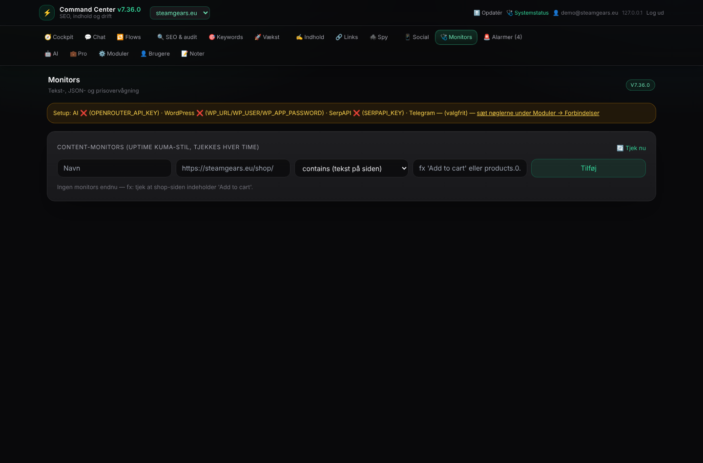

### 9. Alarmer

- Listen over åbne alarmer med type, besked og tid; "Løst" lukker en alarm (`POST /alarms/resolve`)
- **Kanaler**: hvilke af Telegram/e-mail/ntfy/webhook der er sat op, en testalarm pr. kanal og fejlede leveringer med årsag og antal forsøg (se "Alarmer og kanaler")
- Alarmer leveres fra køen `alert_outbox`, så en langsom modtager aldrig blokerer UI'et

### 10. Brugere

- Inviter og slet brugere, skift adgangskode, og se seneste login samt de seneste forsøg med e-mail og IP (se "Login og brugere")
- **MCP-adgang**: opret en nøgle pr. klient (navn + scopes), se hvor mange kald nøglen har lavet, hvornår den sidst blev brugt, og tilbagekald den med ✕. Nøglen vises kun én gang efter oprettelse — gem den med det samme. Under listen står de seneste MCP-kald (audit) med værktøj, varighed og fejl

### 11. Noter

- Hurtige workflow-noter: skriv en note, se de nyeste og slet enkelte (`/notes/add`, `/notes/delete`). Gemmes i tabellen `notes`

### Log ind fra WordPress med ét klik (v7.27)

Knappen **Log ind i Command Center** på Steamgears-dashboardet i WordPress logger dig direkte ind her — uden adgangskode. Det kræver tre ting:

1. `CC_PUBLIC_URL` i `.env` er den adresse, browseren når Command Center på, med `https://` (fx `https://cc.steamgears.eu`).
2. Steamgears Autopilot 7.76 eller nyere på sitet, og Autopilot-broen slået til (`WP_URL`/`WP_USER`/`WP_APP_PASSWORD`).
3. Din WordPress-bruger har **samme e-mail** som din bruger her. Knappen opretter aldrig en ny konto.

Ved hver sync (hver 30. min.) sender Command Center sin adresse og en hemmelig nøgle til pluginnet — kun når noget har ændret sig, eller pluginnet siger at knappen ikke er forbundet. **🔑 Forbind login-knappen nu** i fanen Social gør det med det samme, og kortet viser om knappen er forbundet. Et klik i WordPress laver en billet, der holder **1 minut** og kun virker **én gang**. Afviste billetter tæller som fejlede logins (5 = 10 minutters lås), og hvert login fra WordPress står under Alarmer.

| Login-siden siger | Årsag |
| --- | --- |
| billetten er udløbet | mere end 1 minut gik, eller urene på de to servere er langt fra hinanden |
| allerede brugt | browseren åbnede samme billet to gange — tryk på knappen igen |
| e-mailen findes ikke | din WordPress-e-mail har ingen bruger her — invitér den under Brugere |
| ikke forbundet endnu | ingen sync siden opdateringen — tryk **Forbind login-knappen nu** |

Det gamle engangslink fra v7.17.5 er fjernet: det sendte til en rute, pluginnet aldrig har haft.

### Chat og connectors (v7.26)

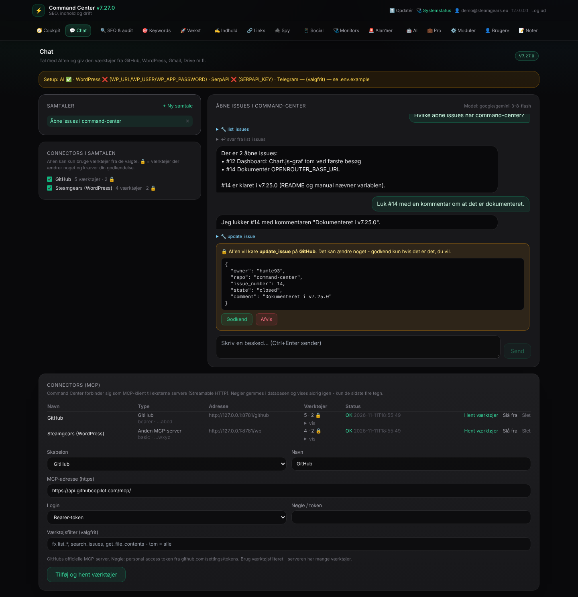

Fanen **💬 Chat** er en samtale med AI'en (OpenRouter, `CHAT_MODEL` eller `AI_MODEL`), hvor modellen kan bruge værktøjer fra de **connectors**, du vælger i venstre side. En connector er en ekstern MCP-server; Command Center forbinder sig som klient (Streamable HTTP).

**Tilføj en connector** nederst på fanen: vælg en skabelon, ret navn/adresse, vælg login og indsæt nøglen. Ved "Tilføj og hent værktøjer" henter Command Center værktøjslisten med det samme og viser antallet — 🔒 markerer værktøjer, der ændrer noget.

| Skabelon | Adresse | Login |
| --- | --- | --- |
| GitHub | `https://api.githubcopilot.com/mcp/` | Personal access token (Bearer) fra github.com/settings/tokens. Brug værktøjsfilteret (fx `list_*, get_*, search_*`), serveren har mange værktøjer |
| Steamgears (WordPress) | `WP_URL` + `/wp-json/mcp/novamira` | `WP_USER` + `WP_APP_PASSWORD` fra `.env` — ingen nøgle i formularen |
| WordPress-site (MCP Adapter) | `https://ditsite.dk/wp-json/mcp/mcp-adapter-default-server` | Brugernavn + Application Password. Kræver pluginnet WordPress MCP Adapter |
| WordPress.com, Gmail, Google Drive | URL fra din MCP-server/gateway | Token fra samme sted. Udbyderne kræver OAuth; login med OAuth direkte fra Command Center er ikke bygget endnu |
| Anden MCP-server | enhver `https://…` | Bearer, Basic, nøgle i egen header eller intet login |

**Sådan virker en samtale**

- Værktøjer med `readOnlyHint` kører automatisk; svaret ses under "↩︎ svar fra …".
- Alle andre værktøjer (også dem uden annotation) stopper chatten med et gult kort: **Godkend** kører kaldet, **Afvis** fortæller AI'en, at du sagde nej. Mens et kald venter, kan der ikke sendes nye beskeder i samtalen, og hvert kald kan kun besluttes én gang. Godkendte kald logges under Alarmer (info).
- Indhold fra værktøjer (mails, sider, issues) er data: AI'en får besked på ikke at følge instruktioner i det.
- Højst 8 værktøjsrunder pr. besked (`CHAT_MAX_STEPS`) og 80 værktøjer i alt pr. samtale; skriv videre for at fortsætte.
- Samtaler er personlige: andre brugere kan hverken se dem eller godkende dine kald.

**Sikkerhed:** nøglen gemmes i `mcp_connectors.secret` og sendes aldrig til browseren igen — kun de sidste fire tegn. Database-backups indeholder derfor nøglerne. Adresser skal bruge `https://` og går gennem SSRF-guarden (`CC_SSRF_ALLOW` åbner for en intern vært), og viderestillinger følges ikke. Chatten tæller med i `AI_MONTHLY_LIMIT` (ét kald pr. runde).

### 12. Moduler

- Slå de 11 funktionsområder fra/til med det samme (se "Moduler" nedenfor)

---

## AI Tools

Samlede AI-værktøjer: titel/meta-rewrites, outreach-drafts, artikel-meta, interne link-forslag og AI-synlighed. Bruger OpenRouter: `OPENROUTER_API_KEY` + `AI_MODEL` (en OpenRouter-slug, default `google/gemini-3-8-flash`; max_tokens 3000 pga. reasoning-tokens). Nøglen laves på openrouter.ai/keys, og modellerne står på openrouter.ai/models. `OPENROUTER_BASE_URL` kan pege på en anden OpenAI-kompatibel adresse. Står kun den gamle `AIMLAPI_KEY` i `.env` (før v7.25.0), bruges den ikke: opstarten skriver en advarsel, og der kommer en alarm under Alarmer. Månedens forbrug tælles og stoppes ved `AI_MONTHLY_LIMIT`.

**AI-synlighed** (fanen *AI*, `/ai/visibility`): stil det spørgsmål en kunde ville stille en AI-assistent (fx "hvor køber jeg steampunk-goggles?"). CC beder modellen om at nævne konkrete butikker og registrerer, om `TRACK_DOMAIN` optræder i svaret — med et uddrag af svaret som dokumentation. Hvert tjek gemmes i `ai_visibility`, så du kan følge, om sitet bliver nævnt i AI-svar over tid. Kræver `OPENROUTER_API_KEY`.

## Pro

Redirect-audit, crawl-diff, sitemap-generator, keyword-sværhedsgrad, content gap, email-finder og pris-overvågning.

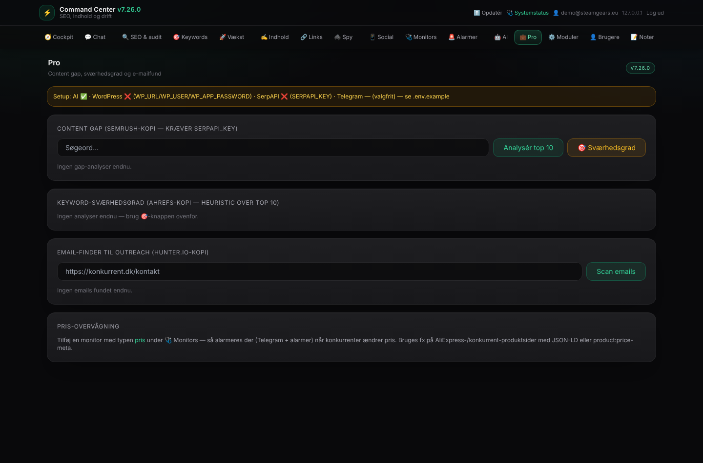

## Moduler

Slå funktionsområder fra/til: `domains, keywords, ai, monitors, social, links, spy, wp_push, telegram, growth, autopilot`.

- **Kerne**: domains + keywords + ai
- **Udvidet**: + monitors, social, links, spy
- **Fuld**: alt inkl. wp_push, telegram, growth og autopilot (WordPress-broen)

Deaktiverede moduler skjuler UI-knapper og stopper cron-jobs (fx kører growth-autopiloten kun når `growth` er til). Ændringer slår igennem med det samme.

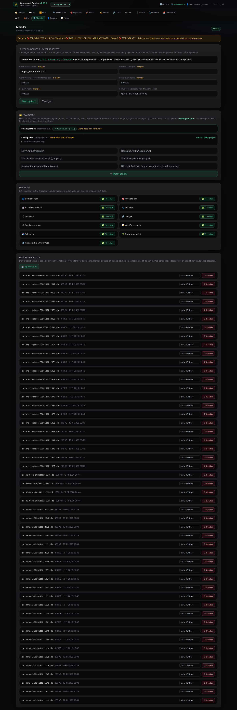

---

## Opdater screenshots

Billederne i `docs/img/` laves af `scripts/screenshots.py`, så de altid viser den kørende version:

```bash
pip install playwright && python3 -m playwright install chromium   # kun foerste gang
python3 scripts/screenshots.py --base http://127.0.0.1:8000 --user din@mail.dk --password 'din-adgangskode'
```

Scriptet logger ind, tager `cc-login.png` og skifter derefter gennem alle 16 faner og gemmer
`cc-cockpit.png` … `cc-notes.png`. Vil du kun opdatere enkelte faner, så brug `--only alarms,notes`,
og vil du kun have det synlige omraade i stedet for hele siden, så tilføj `--viewport`.
Brug `--base`, `--user` og `--password` (eller `CC_BASE`, `CC_USER`, `CC_PASSWORD`).

CI fejler, hvis `app/templates/dashboard.html` er committet efter `docs/img/`. Påvirker ændringen ikke
udseendet, kan tjekket springes over med `[skip screenshots]` i commit-beskeden.

## Opdatering fra GitHub

Cockpit-panelet viser **installeret commit** og **seneste commit på `main`**:

- **Tjek for nye commits** (`POST /update/check`) — SHA, dato og commit-besked, eller den præcise fejl: manglende `GITHUB_TOKEN`, 401/403 (udløbet token) eller 404 (forkert `GITHUB_REPO`). Tjekket kører også automatisk kl. 05:00
- **Opdater** (`POST /update/apply`) — tager en `pre-update`-backup af databasen, henter commit-tarballen fra GitHub og skriver **kun** projektets filer (`app/`, `scripts/`, `deploy/`, `requirements.txt`, `run.sh`, `run.bat`, `install.sh`, `Dockerfile`, `docker-compose.yml`, `.env.example`). `.env`, databasen, `app/backups/` og `..`-stier røres ikke
- **Requirements og genstart klarer den selv**: er `requirements.txt` ændret, køres `pip install -r` i venv'en (5 min timeout, resultatet vises i panelet), og appen genstarter ~1,5 s efter svaret — via systemd-unit hvis den findes, ellers `scripts/restart.sh` (pidfile `app/data/cc.pid` + `run.sh`). Genindlæs siden om et øjeblik
- **Fravalg**: fjern fluebenet “genstart” i panelet, sæt `UPDATE_AUTO_RESTART=0`, eller brug `UPDATE_RESTART_CMD` til din egen supervisor-kommando
- **Fra terminalen**: `bash scripts/update.sh` (tjek + filer + requirements + genstart, venter til `/health` svarer), `--check` kun tjek, `--no-restart` uden genstart. Øverst i svaret står tre linjer: hvilken version der **kører nu** (fra `/health`), hvilken version **filerne** indeholder, og hvilken version **installatøren** vil skrive (`install.sh`s indlejrede `app/main.py`) — plus **login-adressen** fra `CC_PUBLIC_URL` (dvs. den adresse nginx sender videre til). Er de forskellige, skriver scriptet en `forskel`-linje: filerne nyere end processen = genstart mangler; `install.sh` ældre end koden = kør den ikke, den ruller koden tilbage. `bash scripts/update.sh --version` er den samme kontrol som rent svar — kode 0 kun når alle tre stemmer, ellers kode 1 — så den kan bruges i et cron-job eller et deploy-trin.

Opdateringen kører kontrollen automatisk, **før** den skriver noget: er `install.sh` på disken ældre end koden, stopper den med kode 7 og rører ingen filer. Beskeden siger hvad man gør i stedet (`git checkout -- install.sh` eller `git pull`), og at intet er ændret. Grunden er, at en gammel installatør ellers kan ligge klar og rulle koden tilbage, næste gang nogen kører den. `--check` og `--version` skriver intet og virker uanset. `bash scripts/restart.sh` genstarter uden at opdatere
- Status som JSON: `GET /api/update` (inkl. `restart_mode`/`auto_restart`), `POST /api/update/check`, `POST /api/update/apply` (bruges af scriptet). `/self-update` er alias for `/update/apply`

## Flows (v7.30.0)

Fanen **🔁 Flows** kæder funktionerne sammen, så de kører af sig selv.

**Kom i gang:** tryk **➕ Opret flow** på en af de færdige flows. Den er aktiv med det samme og kører efter planen.

| Færdig flow | Plan | Blokke |
|---|---|---|
| Daglig sundhed | dagligt kl. 07 | teknik → monitors → rapport (kun hvis noget er galt) |
| Ugentlig optimering | mandag kl. 06 | crawl → on-page → indhold → AI-titler (hvis fund) → søgeord → note → rapport |
| Indholdsmaskine | onsdag kl. 06 | søgeord → indholdsplan → AI-artikel → WordPress-kladde → rapport |
| Konkurrent-overvågning | fredag kl. 06 | konkurrenter → content gap → backlinks → søgeordsidéer → note |

**Byg din egen:** navn, plan (manuelt, hver time, dagligt, ugentligt + klokkeslæt) og op til 10 blokke. Pr. blok vælger du en
betingelse og evt. et søgeord og et maksimum. Skriver du intet søgeord, bruger blokken dem, flowen har fundet (ord på plads
4-20 fra "Søgeord"), ellers dine gemte søgeord. **Redigér**, **Slå fra/til**, **▶ Kør nu** og **Slet** står på hver flow.

**Blokke:**

| Gruppe | Blok | Kræver |
|---|---|---|
| Analyse | Teknik, Crawl, On-page, Indholdsscore, Monitors, Find konkurrenter | intet |
| Analyse | Søgeord (placeringer), Content gap, Backlink-muligheder | `SERPAPI_KEY` |
| Generér | Søgeordsidéer, Indholdsplan | intet |
| Generér | AI-titler/meta (højst 3 sider), Skriv artikel (højst 2) | `OPENROUTER_API_KEY` |
| Handling | Send nye artikler til WordPress som **kladde** | `WP_URL` + `WP_USER` + `WP_APP_PASSWORD` |
| Handling | Growth-autopilot | `OPENROUTER_API_KEY` |
| Handling | Rapport (Alarmer + dine kanaler), Note | intet |

**Sikkerhed:** intet udgives på sitet — WordPress får kun kladder, og kun artikler der består kvalitetstjekket. Kun én flow (eller
1-klik optimering) kører ad gangen. En blok uden nøgle springes over (⏭️) med en forklaring, og en blok der fejler stopper ikke
resten. Under **Seneste kørsler** ser du hvert trin med ✅/⏭️/❌, tid og fund (de sidste 50 gemmes).

## 1-klik optimering (v7.29.0)

Øverst i **Cockpit**. Adressefeltet er projektet (det første domæne under Domæner, ellers den sidst optimerede adresse).

| Knap | Kører |
|---|---|
| ⚡ Optimér hele projektet | Teknik → crawl → on-page → AI titel/meta → indhold → søgeord → monitors |
| Teknik | oppetid, svartid og SSL for projektet og dine domæner + crawl (404-sider, robots.txt, sitemap) |
| On-page | crawl + titel, meta, overskrifter, links, schema m.m. pr. side + AI-forslag til titel/meta |
| Indhold | crawl + indholdsscore for de 5 svageste sider (ordantal, H2, søgeord, interne links) |
| Søgeord | opdaterer placeringer (med `SERPAPI_KEY`) og fremhæver ord på plads 4-20 ("tæt på toppen") |
| Monitors | kører alle monitors og viser dem, der fejler |

Resultatet er én liste sorteret efter prioritet (høj → middel → lav), med siden, problemet og hvad du gør ved det.
AI-forslag til titel og meta står under siden — klik på et forslag for at kopiere det. **✓ Løst** krydser en handling af.
Intet skrives til WordPress eller sitet; et trin uden nøgle springes over (⏭️) med en forklaring. AI bruges højst på
3 sider pr. kørsel, så et klik ikke bruger budgettet op. Kun én optimering kører ad gangen.

## Funktionsstatus (revision 12. november 2026, v7.28.1)

Alle formularer og knapper er kørt igennem. Uden nøgle siger hver funktion, hvad der mangler (under Alarmer eller i
svaret) — ingen går ned. Hvad hver funktion kræver:

| Funktion | Kræver | Status |
|---|---|---|
| Domæne-tjek, SEO-audit, crawl, redirects, dubletter, linktjek | intet | virker |
| Vækst: optimerer, sammenligning, plan, linkliste | intet | virker |
| Monitors (tekst, JSON, pris), noter, backup, moduler, API-nøgler, brugere (login/kode) | intet | virker (pris-monitor rettet i 7.28.1) |
| 1-klik optimering (teknik, crawl, on-page, indhold, monitors) | intet (AI-forslag og placeringer kræver deres nøgle) | virker (v7.29.0) |
| Flows (automatiske kæder) | blokkene kræver det samme som funktionerne ovenfor | virker (v7.30.0) |
| Konkurrent-søgning (Spy) | intet (DuckDuckGo) | virker, men DuckDuckGo kan blokere servere — så siger alarmen det |
| Søgeordsidéer | intet (Google/DuckDuckGo-forslag) | virker |
| Søgeords-placeringer, backlink-prospekter, content gap, sværhedsgrad | `SERPAPI_KEY` | virker med nøgle |
| Artikler, meta, autopilot, link-forslag, AI-omskrivning, AI-synlighed, Chat | `OPENROUTER_API_KEY` | virker med nøgle (AI-omskrivning rettet i 7.28.1) |
| Core Web Vitals i SEO-audit | `PSI_API_KEY` | virker med nøgle |
| Send artikel/opslag til WordPress, synk, login-knap | `WP_URL` + `WP_USER` + `WP_APP_PASSWORD` | virker med nøgle |
| Invitationer og e-mail-alarmer | `SMTP_HOST` + `SMTP_FROM` | virker med nøgle |
| Telegram/ntfy/webhook-alarmer | kanalens nøgle | virker med nøgle |
| Opdatering fra GitHub-knappen | `GITHUB_TOKEN` | virker med nøgle (ellers `git pull` på serveren) |

## nginx / Ultra.cc

Appen skal blive på `127.0.0.1`; nginx står for TLS:

1. `.env`: `CC_HOST=127.0.0.1`, `CC_PUBLIC_URL=https://<din-adresse>`, `CC_FORWARDED_ALLOW_IPS=127.0.0.1`
2. Start via `./run.sh` eller `deploy/command-center.user.service` (systemd --user, indlæser `.env` som `EnvironmentFile`)
3. VPS: `deploy/nginx-command-center.conf` ind i den `server { }` du bruger, derefter genindlæs nginx.
   Ultra.cc: `deploy/nginx-ultracc-proxy.conf` til `~/.apps/nginx/proxy.d/command-center.conf` (ret porten), derefter `app-nginx restart`
4. Åbn `CC_PUBLIC_URL` — log ind med e-mail og adgangskode (første besøg opretter din bruger, hvis der ingen standardbruger er)

### Eget domæne eller offentlig IP (v7.28)

Det enkleste: ingen nginx, ingen tunnel, ingen token — bare `http://www.ditdomaene.dk:<port>/` (eller `http://<offentlig-ip>:<port>/`)
og login med e-mail og adgangskode. Localhost og lokalnet afvises, og et domæne skal have en A-post til serverens offentlige IP.
`bash scripts/ultracc_setup.sh --domain www.ditdomaene.dk` (eller `--ip`) viser planen, og `--apply` sætter `CC_HOST=0.0.0.0`, `CC_PORT` og
`CC_PUBLIC_URL=http://<ip>:<port>`, stopper `cloudflared`, genstarter og tjekker login-siden. Uden TLS sendes adgangskoden
ukrypteret, og dashboardet viser den gule HTTPS-bjælke som påmindelse. Login-låsen (5 fejl = 10 min. pr. IP) virker også
her: `X-Forwarded-For` bruges kun fra en betroet proxy, så en klient ikke kan skifte "IP" ved hvert forsøg.

### Ultra.cc uden Cloudflare (v7.28)

Ultra.cc giver ikke en egen app sit eget domæne — kun en understi på din faste adresse, fx `https://<bruger>.<server>.usbx.me/cc/`. Før v7.28 kunne appen kun ligge på roden, og derfor blev der brugt en `trycloudflare`-tunnel (ny URL ved hver genstart, så `CC_PUBLIC_URL` og login-knappen i WordPress gik i stykker). Nu:

Hurtigst: `bash scripts/ultracc_setup.sh --url https://<bruger>.<server>.usbx.me/cc` viser planen, og `--apply` udfører skridt 1-4 (inkl. at stoppe `cloudflared`) og tjekker login-siden. Manuelt:

1. `app-ports free` → vælg en port, og skriv den i `.env` som `CC_PORT=<port>` (`CC_HOST=127.0.0.1`)
2. `.env`: `CC_PUBLIC_URL=https://<bruger>.<server>.usbx.me/cc`
3. `cp deploy/nginx-ultracc-proxy.conf ~/.apps/nginx/proxy.d/command-center.conf`, ret `12345` til din port, og kør `app-nginx restart`
4. `bash scripts/restart.sh` og åbn `https://<bruger>.<server>.usbx.me/cc/` — login-siden

Appen fjerner selv `/cc` fra indgående kald (så `/login` på 127.0.0.1 og `scripts/update.sh` virker som før) og sætter det på redirects, session-cookien (`Path=/cc`), `href`/`action`/`src` i HTML og `fetch()`-kald. Selve tunnellen fjernes som beskrevet i [Installation og udrulning §2e](Installation_og_udrulning.md#2e-ultracc-uden-cloudflare).

### Hvorfor `CC_PUBLIC_URL` ofte er tom — og hvad den skal indeholde

`install.sh` skriver kun `.env.example`; den kopierer aldrig til `.env` og spørger ikke om adressen. Opdateringer rører bevidst aldrig `.env`. Kopierer man skabelonen, står der derfor `CC_PUBLIC_URL=` fra dag ét, og den bliver tom, indtil man selv retter linjen. Det ses på tre måder: login-linket i `scripts/update.sh` og `scripts/user_create.py` viser `127.0.0.1`, invitationsmailen får en lokal adresse — og `/mcp` afviser med `421` (eller, når feltet er helt tomt, slår Host-tjekket slet ikke til).

Rigtig form: `CC_PUBLIC_URL=https://humle91.ultra.cc` — med scheme, kun værten, **uden** anførselstegn og uden kommentar på samme linje. På Ultra.cc er det den faste adresse fra panelet + understien: `CC_PUBLIC_URL=https://<bruger>.<server>.usbx.me/cc` (v7.28).

| Skrevet som | Resultat |
|---|---|
| `CC_PUBLIC_URL=` (tom) | login-link = `http://127.0.0.1:8000/login`; Host-tjekket på `/mcp` slås fra |
| `CC_PUBLIC_URL="https://x.ultra.cc"` | `urlparse` finder ingen vært → `/mcp` svarer `421` på alle ikke-lokale værter |
| `CC_PUBLIC_URL=x.ultra.cc` (uden scheme) | samme `421`, og login-linket bliver uden `https://` |
| `CC_PUBLIC_URL=https://x.ultra.cc/` | virker; login-linket får ikke dobbelt `/` |
| `CC_PUBLIC_URL=https://x.usbx.me/cc` | virker (v7.28): appen ligger på understien `/cc`, login-linket er `…/cc/login` |

Tjek altid med `bash scripts/update.sh --check`: står der `127.0.0.1` som login-adresse, er linjen tom eller forkert skrevet.

Proxy-blokken skal sende `X-Forwarded-Proto` (ellers bliver cookien ikke `Secure`, og der vises en HTTPS-advarsel), `X-Forwarded-For` (så login-låsen rammer klienten) og have `proxy_read_timeout 300s` (crawl/AI-kald tager minutter). Understi (`/cc/`) virker fra v7.28, når den står i `CC_PUBLIC_URL`; nginx må ikke strippe den.


## MCP-adgang (v7.17)

Agenter og editorer (Claude, Codebuff m.fl.) kan både læse og handle i Command Center over **MCP** på
`/mcp` (Streamable HTTP med JSON-svar).

1. Fanen **Brugere → MCP-adgang**: skriv et navn (fx "Claude Desktop"), vælg `read` (kun læsning)
   eller `read,write` (læsning + handlinger), og tryk **Opret nøgle**. Nøglen (`cc_…`) vises én gang —
   kopiér den med det samme: den ligger kun i klartekst i databasen indtil siden er vist (højst 15 min.),
   og derefter findes den kun som hash. Genindlæser du dashboardet, er nøglen væk, og du skal oprette en ny.
2. Peg klienten på `https://<din-adresse>/mcp` og send nøglen som `Authorization: Bearer cc_…`.
3. Vil du hellere gøre det fra terminalen:

```bash
python3 scripts/api_key.py create "Claude Desktop" read   # nøglen skrives ud én gang
python3 scripts/api_key.py list                           # navn, halen af nøglen, scopes, sidst brugt
python3 scripts/api_key.py revoke 2                        # virker med det samme
python3 scripts/api_key.py audit 20                       # de seneste MCP-kald pr. nøgle
```

Læse-værktøjer: `health` (version, DB, brugere, åbne alarmer, seneste crawl), `crawl_summary`,
`keywords`, `monitors`, `alarms_open`, `notes` og `history` (kræver `domain_id`).

Skrive-værktøjer (kun med `write`-scope):

| Værktøj | Gør | Argumenter |
| --- | --- | --- |
| `start_crawl` | starter et site-crawl i baggrunden | `url`, `level` (quick/standard/deep), `max_pages` (5–100) |
| `add_monitor` | opretter en monitor | `name`, `url`, `type` (contains/json/price), `expected` |
| `resolve_alarm` | markerer en alarm som løst | `id` (fra `alarms_open`) |
| `add_note` | skriver en note i dashboardet | `content` (2–2000 tegn) |

`start_crawl` afvises, hvis der allerede kører et crawl, og svarer med et overslag og
`/api/crawl/status`, så agenten kan følge fremdriften. `add_monitor` opretter ikke samme url+type to
gange (den svarer `created: false` med den eksisterende id).

- Nøglen gemmes kun som sha256; databasen kan ikke genskabe den. Selve nøglen har ingen udløbsdato —
  tilbagekald den, når klienten ikke skal have adgang mere. Den ene række med klartekst, der vises i
  dashboardet, slettes i samme kald som visningen; den daglige oprydning fjerner en glemt række.
- `scopes` er `read` (syv læse-værktøjer) eller `read,write` (også de fire skrive-værktøjer). Manglende
  scope giver `-32003`, og afvisningen havner i auditten.
- Endpointet validerer `Host` mod `CC_PUBLIC_URL` (ellers `421`) og `Origin` (fremmed origin giver `403`),
  så en fremmed webside ikke kan bruge nøglen fra browseren. Uden nøgle svarer det `401` med
  `WWW-Authenticate: Bearer`.
- Brug af en nøgle opdaterer "sidst brugt" i tabellen, så en glemt nøgle er nem at få øje på.
- **Audit pr. nøgle**: hvert værktøjskald gemmes i `api_audit` (nøgle, værktøj, ok/fejl, årsag,
  varighed, tid) og vises under nøglerne. Også afviste kald gemmes: manglende scope, en fejl i
  værktøjet og et **ukendt værktøjsnavn**, så et nøgle der famler eller prøver ting af kan ses. Rækker
  ældre end 90 dage ryddes af den daglige oprydning.
- Plan og baggrund: [`Command_Center_MCP.md`](Command_Center_MCP.md).

## API (til automatisering)

Alle routes kræver en indlogget bruger (cookie) - samme session som UI'et. Vigtigste:

- `POST /articles/generate` (form: keyword) · `POST /articles/push` · `POST /articles/autopilot`
- `POST /keywords/add` · `GET /api/visibility` · `GET /api/health-history`
- `POST /backlinks/prospect` · `POST /seo/audit` · `POST /seo/crawl`
- `GET /health` · `POST /settings/module` · `GET /api/update` · `POST /update/check` · `POST /update/apply`
- `POST /mcp` (MCP, kræver `Authorization: Bearer cc_…` i stedet for cookie) · `POST /api-keys/create`, `/api-keys/revoke` (cookie)
- `POST /self-update` (alias for `/update/apply`)

## Environment-variabler (.env)

`CC_HOST`, `CC_PORT`, `CC_PUBLIC_URL`, `CC_FORWARDED_ALLOW_IPS`, `GITHUB_TOKEN`, `GITHUB_REPO`, `UPDATE_AUTO_RESTART`, `UPDATE_RESTART_CMD`, `OPENROUTER_API_KEY`, `AI_MODEL`, `OPENROUTER_BASE_URL`, `CHAT_MODEL`, `CHAT_MAX_TOKENS`, `MCP_TIMEOUT`, `WP_URL/USER/APP_PASSWORD`, `TELEGRAM_BOT_TOKEN`, `TELEGRAM_CHAT_ID`, `SMTP_HOST`, `SMTP_PORT`, `SMTP_USER`, `SMTP_PASS`, `SMTP_FROM`, `SMTP_TO`, `SMTP_TLS`, `NTFY_URL`, `NTFY_TOPIC`, `NTFY_TOKEN`, `ALERT_WEBHOOK_URL`, `ALERT_WEBHOOK_SECRET`, `ALERT_MIN_SEVERITY`, `ALERT_QUIET_HOURS`, `ALERT_DEDUPE_MINUTES`, `SERPAPI_KEY`, `TRACK_DOMAIN`, `PSI_API_KEY`, `SSL_WARN_DAYS`, `LINKCHECK_LIMIT`, `SERPAPI_MONTHLY_LIMIT`, `AI_MONTHLY_LIMIT`, `QUALITY_MIN_WORDS`.

Rigtige miljøvariabler vinder over `.env`. `.env` læses før appens konfiguration, og inline-kommentarer (`KEY=  # note`) fjernes.

## Drift

- **Cron**: domæne-tjek hver 6. time · keywords 06:00 · autopilot 05:15 · oprydning 04:30 · DB-backup 04:40 · GitHub-tjek 05:00 · Autopilot-bro hver 30. min · WP-Cron-ping hvert 5. min · alarmkøen (`alert_outbox`) leveres hvert minut
- **Backup**: `app/backups/cc-daglig-*.db` (14 gemmes) og `cc-pre-update-*.db` før hver opdatering
- **Health**: `/health` returnerer 503 ved kritisk DB/disk-tilstand og viser månedens API-forbrug
- **Tests**: `python3 tests/test_v8_features.py` og `bash tests/ci_check.sh` (boot, alle sider, auth, WordPress-bro og link-audit)
- **Backup og gendannelse i UI**: fanen Moduler viser alle backups (nyeste først) med størrelse og tidspunkt. "Tag backup nu" laver en manuel backup. "Gendan" kræver at du skriver `GENDAN` i feltet ved siden af; systemet tager først en `pre-restore`-backup af den nuværende database og gendanner kun en fil, der består integritetstjekket og indeholder brugertabellen. Hvis den sikkerhedskopi fejler, gendannes der intet.
- **Rollback (manuelt, hvis UI'et ikke kan bruges)**: stop appen, gendan `app/data/center.db` fra `app/backups/`, og kør `install.sh`/GitHub-opdatering igen

## Fejlfinding

| Symptom | Tjek |
| "… er en intern adresse" | CC afviser at hente en URL, der peger på loopback, et privat net eller sky-metadata (SSRF). Ret URL'en, eller sæt `CC_SSRF_ALLOW=vaerten` i `.env`, hvis det er en intern side, du faktisk vil måle |
| --- | --- |
| Bliver logget ud hele tiden | Bag nginx: mangler `X-Forwarded-Proto`? Så sættes cookien ikke `Secure` korrekt, og HTTPS-advarslen vises |
| "GITHUB_TOKEN mangler" i opdaterings-panelet | Sæt token i `.env` (privat repo) og genstart appen |
| 504 fra nginx ved crawl/AI-kald | `proxy_read_timeout 300s` i nginx-blokken |
| Login låst | 5 fejl = 10 min pr. IP; vent eller genstart appen |
| Kan ikke invitere en bruger | Gyldig e-mail + `SMTP_HOST`/`SMTP_FROM` i `.env`; fejlen står nu direkte i formularen (og under Alarmer). Uden SMTP: `python3 scripts/invite.py adresse --print` og send mailen selv. Adgangskode ved direkte oprettelse: min. 8 tegn. Uden SMTP og uden invitation: `python3 scripts/user_create.py adresse --username navn` |
| Ingen adgang til `/api/*` | Log ind igen - API'et kræver en aktiv session (cookie), ikke en token |
| Appen starter ikke efter opdatering | `pip install -r requirements.txt` (gør `./run.sh`), og se `journalctl --user -u command-center` |

## Installation

```bash
# Hent install.sh fra det private repo (raw-download med din GitHub-token) og kør den
bash install.sh
```

Scriptet selv-installerer (venv, deps, `.env`-skabelon, nginx-config, systemd-unit) og er idempotent.


## Alarmer og kanaler (v7.12)

Alarmer (døde domæner, ændrede priser, fejlede keyword-tjek, budgetloft, strategi-mangler, forsinkede eller fejlede jobs) sendes nu
til de kanaler du sætter i `.env`:

| Kanal | Variabler |
|---|---|
| Telegram | `TELEGRAM_BOT_TOKEN`, `TELEGRAM_CHAT_ID` |
| E-mail | `SMTP_HOST`, `SMTP_PORT`, `SMTP_USER`, `SMTP_PASS`, `SMTP_FROM`, `SMTP_TO`, `SMTP_TLS` |
| ntfy | `NTFY_URL`, `NTFY_TOPIC`, `NTFY_TOKEN` |
| Webhook | `ALERT_WEBHOOK_URL`, `ALERT_WEBHOOK_SECRET` |

`ALERT_MIN_SEVERITY` (info/advarsel/kritisk) filtrerer støj, `ALERT_QUIET_HOURS=23-7` holder
ikke-kritiske alarmer væk om natten, og `ALERT_DEDUPE_MINUTES` (standard 180) sikrer at den samme
alarm ikke spammer. Genstart efter ændringer. Under fanen **Alarmer** ser du hvilke kanaler der er
aktive, kan sende en testalarm pr. kanal, og se hvorfor en levering eventuelt fejlede — appen prøver
automatisk igen med stigende interval i op til fem forsøg.

E-mail kræver en app-adgangskode (Google/Fastmail), ikke din normale adgangskode.
Webhooken kan verificeres med `webhook-signature`-headeren, hvis modtageren kender hemmeligheden.


## Opstart, login-IP og kørselsrapport (v7.13)

Ved opstart printer appen version og de nyeste ændringer. Samme tekst havner i `app/data/startup.log`,
og `run.sh`, `run.bat`, `scripts/restart.sh`, `scripts/update.sh` og `install.sh` viser versionen, så
du altid kan se hvad der kører. `scripts/update.sh` viser versionen på disken, den kørende proces'
svar fra `/health` **og** den version `install.sh` vil skrive, advarer når de ikke følges ad, og
skriver login-adressen med, så du ikke skal grave `CC_PUBLIC_URL` op i `.env` for at finde ind.
`bash scripts/update.sh --version` giver svaret som kode: 0 = de tre kilder stemmer, 1 = mindst én
afviger (med en `forskel`-linje der siger hvilken). Det er den kontrol, der fanger en gammel
`install.sh`, inden den overskriver koden med en ældre version.

Login registrerer IP'en bag hvert forsøg: under fanen **Brugere** ser du seneste login pr. bruger
(IP + tid) og de sidste otte forsøg, inkl. fejlede. Bag nginx kræver det, at `CC_FORWARDED_ALLOW_IPS`
matcher proxyens adresse (standard `127.0.0.1`), ellers vises proxyens IP.

Login-siden viser en kort kørselsrapport, før du logger ind: version og commit, seneste opstart, åbne
alarmer, antal domæner/keywords/monitors, seneste domænetjek og crawl, database-størrelse og din IP.
Rapporten indeholder bevidst ikke alarmtekster eller brugernavne.
